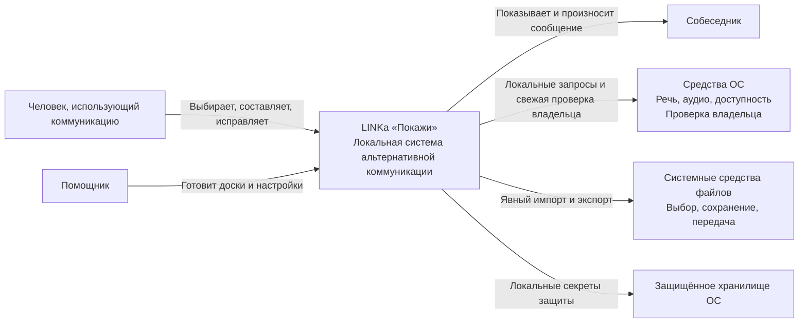
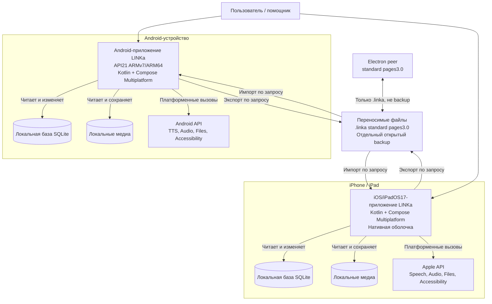
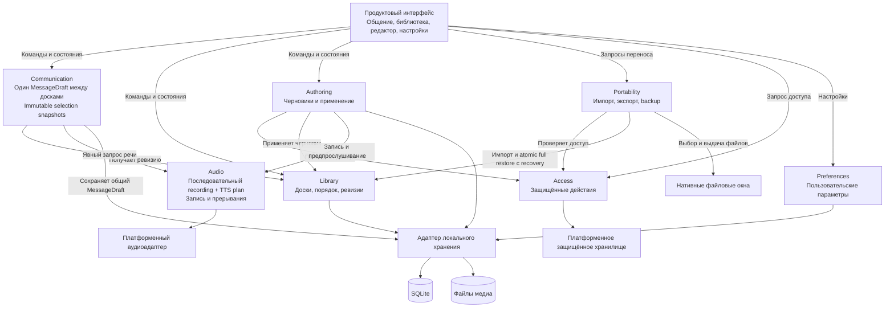
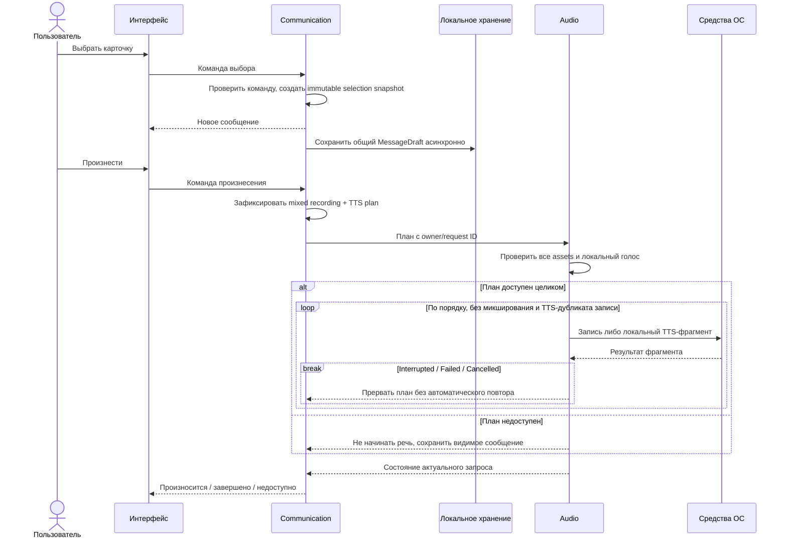
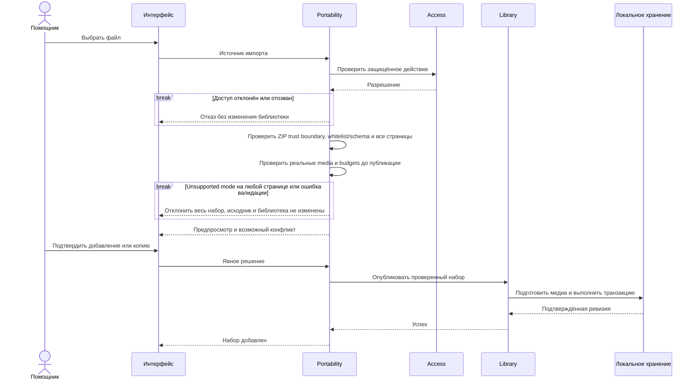

# 4. C4

[К содержанию](README.md) · [Назад: правила дизайна](03-design-system.md)

Ниже — **целевая архитектура**, а не карта существующего Android-кода.

Стек принят и [закреплён](../development/toolchain.md): KMP + Compose Multiplatform. Цели — Android API21 ARMv7/ARM64 и iOS/iPadOS17, не iOS14. G0/G1, реальный ARMv7 и native codec gaps **OPEN**; условный coding P02–P14 разрешён, но готовность продукта, safety и выпускные gates этим не доказаны. [Фактический статус](../development/implementation-status.md).

В C4 контейнер означает исполняемое приложение или хранилище, а не Docker-контейнер. Общая Kotlin-библиотека не изображается отдельным сервером.

## 4.1. C1 — системный контекст

### Смысл отношений

- Основной пользователь не зависит от помощника при обычном общении.
- Помощник — роль внутри локального приложения.
- Собеседник не обязан пользоваться программой.
- ОС предоставляет возможности, но не определяет смысл сообщения.
- Системная передача файла может использовать выбранного пользователем провайдера.
- Сервер LINKa отсутствует.

## 4.2. C2 — контейнеры

### Принципиальные свойства

- Android и iOS работают независимо.
- Их базы не являются репликами автоматически.
- Общий код включён в каждое приложение при сборке.
- Между приложениями нет скрытого RPC или синхронизации.
- Переносимость обеспечивается контрактом файлов и медиа.
- Для запуска не нужны Docker, PostgreSQL и backend.

## 4.3. C3 — модули внутри мобильного приложения

### Существенные ограничения

**UI → доменная команда**, а не UI → ZIP-файл.

**Communication → Audio**, а не каждая карточка → собственный проигрыватель.

**Authoring → Library**, а не редактор напрямую перезаписывает действующий архив.

**Portability → Library**, а не импорт копирует непроверенный файл поверх рабочего набора.

**Access проверяется там, где исполняется изменение**, а не только при показе меню.

### Контракты основных взаимодействий

| Взаимодействие | Что знает вызывающий |
|---|---|
| Выбор карточки | ID команды/элемента и сеанс; результат — неизменяемый снимок с pinned assets |
| Произнесение | Неизменяемый mixed recording/TTS plan и owner/request ID |
| Открытие редактора | Доска и исходная ревизия |
| Применение черновика | Ожидаемая ревизия и подготовленные данные |
| Импорт | Выбранный источник и явное решение о конфликте |
| Экспорт | Согласованный снимок и выбранное назначение |
| Запись | Владелец операции и явное начало/завершение |
| Полное восстановление | Проверенный backup, подтверждение замены и recovery до atomic switch; пустой MessageDraft, неизменная защита |

Вызывающий не управляет внутренними временными файлами и платформенными callback.

## 4.4. Динамическая модель: выбор и произнесение

Сохранение снимка не должно блокировать визуальную реакцию. При этом подтверждённое состояние сохранения отличается от ещё выполняющейся записи.

План не начинается, если предварительная проверка целиком не пройдена; loop продолжается только после Completed, остальные результаты прерывают его без автоматического повтора. Сообщение сохраняется между досками и при compose/direct. Direct не меняет фразу; навигация не запускает речь и не очищает её. Смена страницы/доски сохраняет уже звучащий снимок, закрытие останавливает звук. Backspace удаляет снимок или одну графему; clear имеет один ограниченный undo, не восстанавливаемый после перезапуска. Правка источника не меняет выбранный снимок; GC учитывает его assets и активный playback.

## 4.5. Динамическая модель: импорт

Сообщение «Набор добавлен» появляется после публикации, а не после выбора файла или чтения его имени.

Reader принимает fixtures whitelist legacy и pages/3.0; writer — standard pages/3.0. Неисполняемые metadata пассивно сохраняются. Проверяются NFC/case collisions, symlink, безопасные относительные пути, конфликты файл/каталог, реальные streamed bytes и image decode budget; бюджет не выше 2000 entries/500 MiB peer с уточнением отдельных лимитов в P05. `UUID..wav` не равен компоненту `..`. Исходник не меняется; перестройка layout разрешена, потеря overflow/содержательных карточек — нет. Не требуется новая категоризация.

Backup — отдельный открытый versioned формат, roots `boards/drafts/settings/media`, с предупреждением о незашифрованных изображениях/голосе/черновиках и системном cloud-провайдере. MessageDraft/undo, их эксклюзивные assets, секреты и lock исключены. Restore проверяет всё в staging и место, показывает полную замену; после подтверждения создаёт recovery прежней библиотеки **до** atomic switch библиотеки и настроек. Без recovery замены нет; ошибка оставляет прежнюю рабочей. После успеха сообщение пусто, текущая защита неизменна, речь не запускается. Recovery не удаляется до проверки результата/явного отказа от возврата.

Восстановление забытого пароля требует свежей системной проверки владельца, отзывает assistant sessions и не удаляет библиотеку; reset app/data не применяется. Новая блокировка требует доступной реальной проверки владельца, legacy-lock сохраняется независимо от новых prerequisites. Access проверяет команды, capability не восстанавливается из UI-state.

## 4.6. Развёртывание и владение данными

На каждом устройстве:

- приложение работает в собственном процессе;
- база и медиа находятся в закрытом хранилище приложения;
- защищённые значения находятся в платформенном хранилище;
- системные речевые возможности живут по правилам ОС;
- переносимые файлы выходят из закрытого хранилища только по явному действию;
- удаление приложения может удалить локальные данные — интерфейс резервных копий обязан честно это объяснять.

Никакой центральный сервис не является условием доступности общения.

## 4.7. Уровень C4 Code

Диаграмма фактических классов здесь не задаётся: bootstrap и текущий ход реализации не означают готовности целевого продукта; этот документ фиксирует принятые границы, не инвентаризацию кода.

Для этого документа достаточно:

- C1 — назначение и окружение;
- C2 — устанавливаемые приложения и хранилища;
- C3 — ответственность модулей;
- динамические диаграммы;
- инварианты и контракты доменной модели.

Выдуманная диаграмма десятков будущих классов создала бы видимость точности без дополнительной архитектурной пользы.
