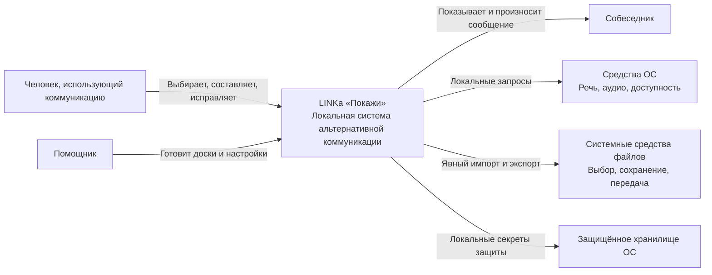
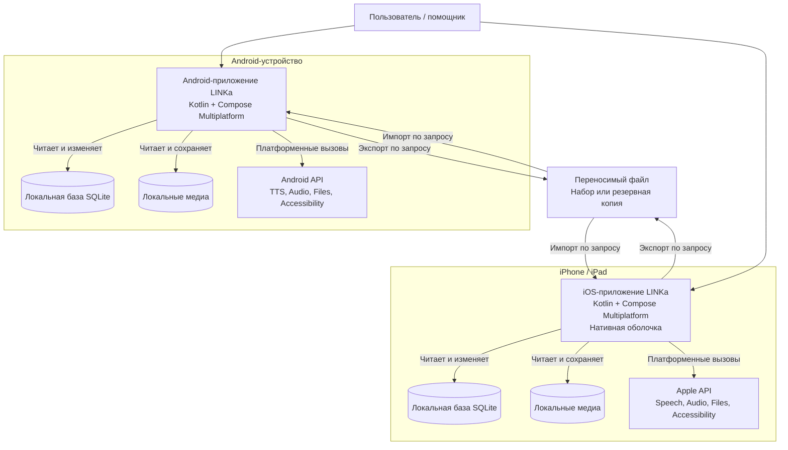
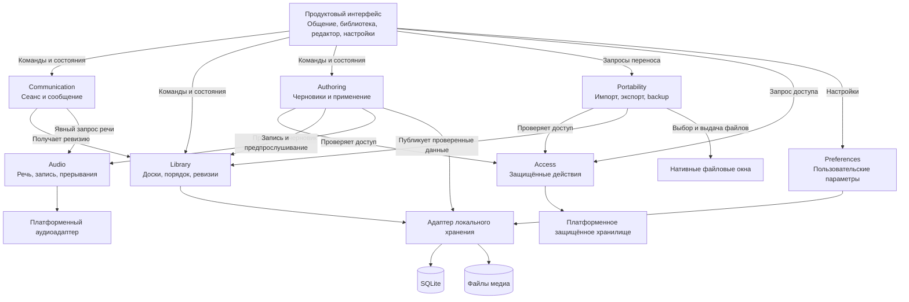
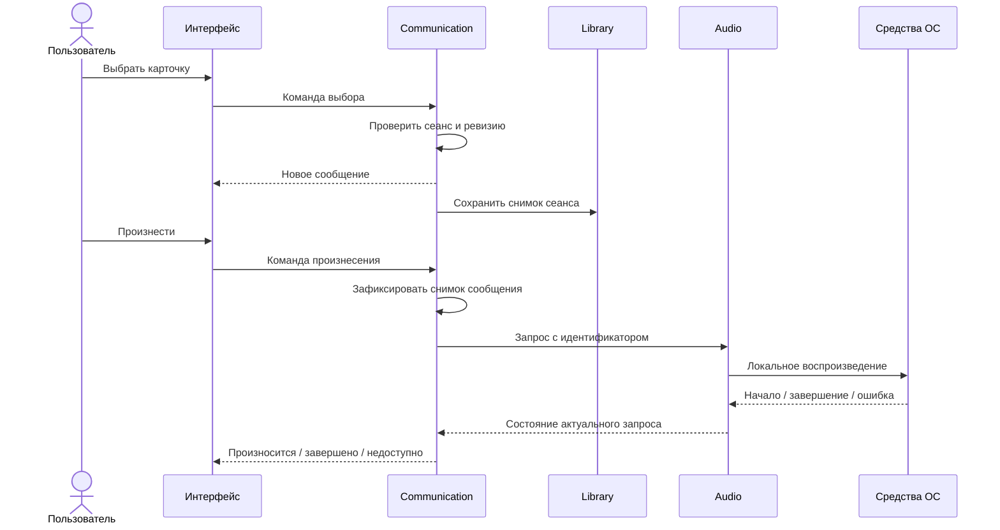
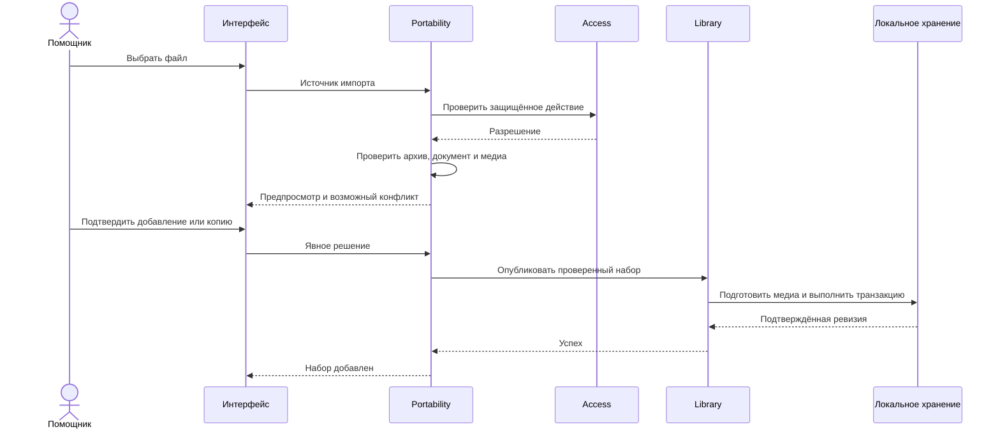

# 4. C4

[К содержанию](README.md) · [Назад: правила дизайна](03-design-system.md)

Ниже — **целевая архитектура**, а не карта существующего Android-кода.

В C4 контейнер означает исполняемое приложение или хранилище, а не Docker-контейнер. Общая Kotlin-библиотека не изображается отдельным сервером.

## 4.1. C1 — системный контекст

### Смысл отношений

- Основной пользователь не зависит от помощника при обычном общении.
- Помощник — роль внутри локального приложения.
- Собеседник не обязан пользоваться программой.
- ОС предоставляет возможности, но не определяет смысл сообщения.
- Системная передача файла может использовать выбранного пользователем провайдера.
- Сервер LINKa отсутствует.

## 4.2. C2 — контейнеры

### Принципиальные свойства

- Android и iOS работают независимо.
- Их базы не являются репликами автоматически.
- Общий код включён в каждое приложение при сборке.
- Между приложениями нет скрытого RPC или синхронизации.
- Переносимость обеспечивается контрактом файлов и медиа.
- Для запуска не нужны Docker, PostgreSQL и backend.

## 4.3. C3 — модули внутри мобильного приложения

### Существенные ограничения

**UI → доменная команда**, а не UI → ZIP-файл.

**Communication → Audio**, а не каждая карточка → собственный проигрыватель.

**Authoring → Library**, а не редактор напрямую перезаписывает действующий архив.

**Portability → Library**, а не импорт копирует непроверенный файл поверх рабочего набора.

**Access проверяется там, где исполняется изменение**, а не только при показе меню.

### Контракты основных взаимодействий

| Взаимодействие | Что знает вызывающий |
|---|---|
| Выбор карточки | Идентификатор элемента и текущий сеанс |
| Произнесение | Снимок сообщения и выбранная политика речи |
| Открытие редактора | Доска и исходная ревизия |
| Применение черновика | Ожидаемая ревизия и подготовленные данные |
| Импорт | Выбранный источник и явное решение о конфликте |
| Экспорт | Согласованный снимок и выбранное назначение |
| Запись | Владелец операции и явное начало/завершение |

Вызывающий не управляет внутренними временными файлами и платформенными callback.

## 4.4. Динамическая модель: выбор и произнесение

Сохранение снимка не должно блокировать визуальную реакцию. При этом подтверждённое состояние сохранения отличается от ещё выполняющейся записи.

## 4.5. Динамическая модель: импорт

Сообщение «Набор добавлен» появляется после публикации, а не после выбора файла или чтения его имени.

## 4.6. Развёртывание и владение данными

На каждом устройстве:

- приложение работает в собственном процессе;
- база и медиа находятся в закрытом хранилище приложения;
- защищённые значения находятся в платформенном хранилище;
- системные речевые возможности живут по правилам ОС;
- переносимые файлы выходят из закрытого хранилища только по явному действию;
- удаление приложения может удалить локальные данные — интерфейс резервных копий обязан честно это объяснять.

Никакой центральный сервис не является условием доступности общения.

## 4.7. Уровень C4 Code

Диаграмму фактических классов целевой реализации здесь не задаю: целевого кода ещё нет, а запрос ограничен архитектурой.

Для этого документа достаточно:

- C1 — назначение и окружение;
- C2 — устанавливаемые приложения и хранилища;
- C3 — ответственность модулей;
- динамические диаграммы;
- инварианты и контракты доменной модели.

Выдуманная диаграмма десятков будущих классов создала бы видимость точности без дополнительной архитектурной пользы.
