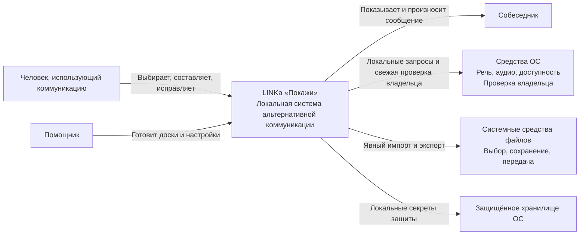
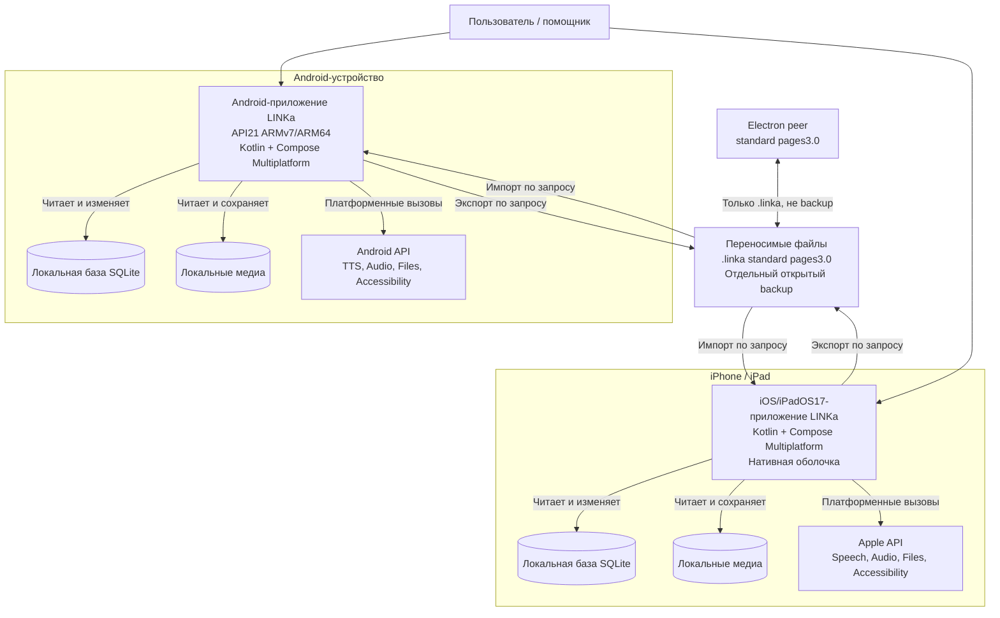
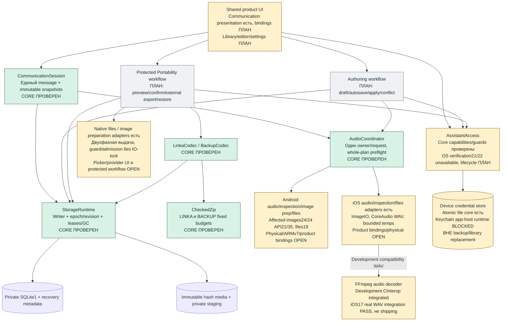
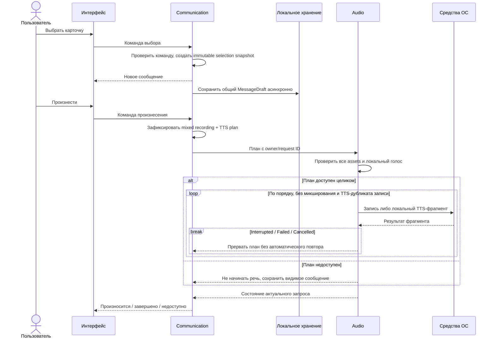
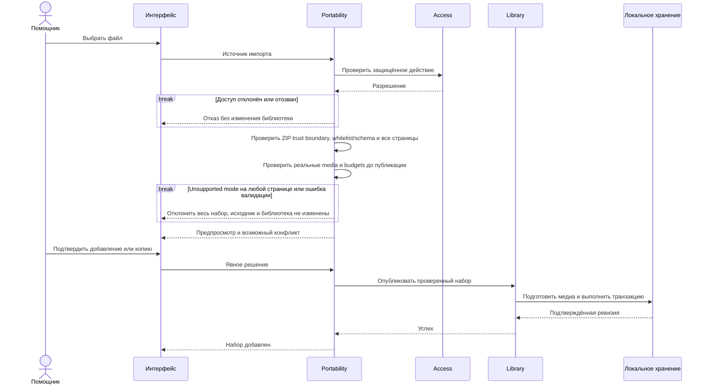

# 4. C4

[К содержанию](README.md) · [Назад: правила дизайна](03-design-system.md)

Ниже C1/C2 — **целевая архитектура**, C3 различает реализованное ядро и незавершённые продуктовые швы. Это не карта готового установленного приложения.

Стек принят и [закреплён](../development/toolchain.md): KMP + Compose Multiplatform. Цели — Android API21 ARMv7/ARM64 и iOS/iPadOS17, не iOS14. G0/G1, реальный ARMv7 и native codec gaps **OPEN**; условный coding P02–P14 разрешён, но готовность продукта, safety и выпускные gates этим не доказаны. [Фактический статус](../development/implementation-status.md).

В C4 контейнер означает исполняемое приложение или хранилище, а не Docker-контейнер. Общая Kotlin-библиотека не изображается отдельным сервером.

## 4.1. C1 — системный контекст



### Смысл отношений

- Основной пользователь не зависит от помощника при обычном общении.
- Помощник — роль внутри локального приложения.
- Собеседник не обязан пользоваться программой.
- ОС предоставляет возможности, но не определяет смысл сообщения.
- Системная передача файла может использовать выбранного пользователем провайдера.
- Сервер LINKa отсутствует.

## 4.2. C2 — контейнеры



### Принципиальные свойства

- Android и iOS работают независимо.
- Их базы не являются репликами автоматически.
- Общий код включён в каждое приложение при сборке.
- Между приложениями нет скрытого RPC или синхронизации.
- Переносимость обеспечивается контрактом файлов и медиа.
- Для запуска не нужны Docker, PostgreSQL и backend.

На переходе normal Android ещё использует legacy writers, а новый StorageRuntime не подключён к пользовательской библиотеке; normal iOS — development shell. Старый путь удаляется после подтверждённого паритета и migration safety, не до них. Probe/test APK — проверочная инфраструктура, не третий продукт. У каждого целевого приложения private SQLite+immutable media, а device credentials отдельно от backup/library replacement. Electron читает только `.linka`, не полный backup.

## 4.3. C3 — модули внутри мобильного приложения



### Существенные ограничения

**UI → доменная команда**, а не UI → ZIP-файл.

**Communication → Audio**, а не каждая карточка → собственный проигрыватель.

**Authoring → Library**, а не редактор напрямую перезаписывает действующий архив.

**Portability → Library**, а не импорт копирует непроверенный файл поверх рабочего набора.

**Access проверяется там, где исполняется изменение**, а не только при показе меню.

### Контракты основных взаимодействий

| Взаимодействие | Что знает вызывающий |
|---|---|
| Выбор карточки | ID команды/элемента и сеанс; результат — неизменяемый снимок с pinned assets |
| Произнесение | Неизменяемый mixed recording/TTS plan и owner/request ID |
| Открытие редактора | Доска и исходная ревизия |
| Применение черновика | Ожидаемая ревизия и подготовленные данные |
| Импорт | Выбранный источник и явное решение о конфликте |
| Экспорт | Согласованный снимок и выбранное назначение |
| Запись | Владелец операции и явное начало/завершение |
| Полное восстановление | Проверенный backup, подтверждение замены и recovery до atomic switch; пустой MessageDraft, неизменная защита |

Вызывающий не управляет внутренними временными файлами и платформенными callback.

## 4.4. Динамическая модель: выбор и произнесение



Сохранение снимка не блокирует визуальную реакцию: один in-flight+latest pending, не очередь всей истории. Подтверждённое состояние сохранения отличается от ещё выполняющейся записи. NUL/ill-formed native speech text отклоняется до первого utterance, не произносится только префикс.

План не начинается, если предварительная проверка целиком не пройдена; loop продолжается только после Completed, остальные результаты прерывают его без автоматического повтора. Сообщение сохраняется между досками и при compose/direct. Direct не меняет фразу; навигация не запускает речь и не очищает её. Смена страницы/доски сохраняет уже звучащий снимок, закрытие останавливает звук. Backspace удаляет снимок или одну графему; clear имеет один ограниченный undo, не восстанавливаемый после перезапуска. Правка источника не меняет выбранный снимок; GC учитывает его assets и активный playback.

## 4.5. Динамическая модель: импорт



Сообщение «Набор добавлен» появляется после публикации, а не после выбора файла или чтения его имени.

Reader принимает whitelist1.0/1.2/2.0/3.0; writer — standard pages/3.0. Direct active keys отвергают весь архив, nested metadata остаются opaque. Проверяются NFC/case collisions, symlink, безопасные относительные пути, конфликты файл/каталог, реальные streamed bytes и image decode budget; LINKA2000 entries/500MiB, BACKUP60000/2GiB используют один CheckedZip. Строгая DEFLATE canonicality не доказана из-за prefetch, size/CRC/hash/budgets остаются обязательными. `UUID..wav` не равен компоненту `..`. Исходник не меняется; canonical uniform1×1 сохраняет content/overflow/explicit EMPTY, не вводит категоризацию.

Backup — отдельный открытый `.linkabackup` schema1, roots `boards/drafts/settings/media`, с предупреждением о незашифрованных изображениях/голосе/черновиках и системном cloud-провайдере. MessageDraft/undo, их эксклюзивные assets, секреты и lock исключены. Retained ARCHIVE raw/hash-only. Restore проверяет всё в staging и место, показывает полную замену; после подтверждения создаёт recovery прежней библиотеки **до** atomic switch. Подробный исход commit различается ниже; неизвестность не выдаётся за rollback.

Восстановление забытого пароля требует свежей системной проверки владельца, отзывает assistant sessions и не удаляет библиотеку; reset app/data не применяется. Новая блокировка требует доступной реальной проверки владельца, legacy-lock сохраняется независимо от новых prerequisites. Access проверяет команды, capability не восстанавливается из UI-state.

### Commit и полное восстановление

```mermaid
sequenceDiagram
    participant WF as Защищённый workflow
    participant ST as Единственный StorageRuntime writer
    participant G as Fresh guard
    participant DB as SQLite1
    WF->>WF: Staging / limits / hash / roles / preview / confirmation
    WF->>ST: Expected epoch/revisions + prepared snapshot
    ST->>DB: BEGIN IMMEDIATE
    ST->>G: Проверка перед mutation
    ST->>DB: Recovery + entries/drafts/settings/refs + epoch++ + empty message
    ST->>G: Проверка непосредственно перед COMMIT
    ST->>DB: COMMIT
    alt Подтверждённый commit
        ST-->>WF: Completed + доказанный stamp даже при refresh error
    else COMMIT/ROLLBACK exception
        ST->>ST: Закрыть suspect writer, одна independent reconciliation
        alt Доказан exact old/new durable state
            ST-->>WF: Доказанный Failed/Cancelled либо Completed
        else Доказательства нет
            ST-->>WF: UnconfirmedCommit; quarantine writes/GC
        end
    end
```

Подготовка/hash/decoder вне SQL lock, finalize media+lease под writer; lock order writerMutex→pinsLock. При initial schema admission SQLite открывает owned stable probe-copy DB/WAL/journal, не source; SHM не копируется, unknown source не checkpoint-ится. После quarantine — explicit close/reopen, authoritative read, без auto retry/replay/speech. Существующий singleton recovery даёт CONFLICT, return меняет current/recovery местами, delete — отдельное protected+confirmed действие. Credentials вне переключения.

### Native file authority — незавершённый шов

COORD принял двухфазный port: выбор scoped destination без выдачи содержимого → foreground confirmation/свежая авторизация → single-use guarded write. Guard перед внешним open/truncate — irreversible point, далее проверки между bounded chunks; cancel/revoke могут оставить внешнюю частичную копию, rollback provider не обещается. Старая UI-кнопка или прошлый success не авторизуют поздний callback. Source URI не постоянная ссылка, temp/compatibility output не immutable original; scope/lease закрывает владелец. [Policy/матрица](../development/access-policy.md) приняты, native binding и actual picker/background/revocation acceptance ещё OPEN.

## 4.6. Развёртывание и владение данными

На каждом устройстве:

- приложение работает в собственном процессе;
- база и медиа находятся в закрытом хранилище приложения;
- защищённые значения находятся в платформенном хранилище;
- системные речевые возможности живут по правилам ОС;
- переносимые файлы выходят из закрытого хранилища только по явному действию;
- удаление приложения может удалить локальные данные — интерфейс резервных копий обязан честно это объяснять.

Никакой центральный сервис не является условием доступности общения.

## 4.7. Уровень C4 Code

Диаграмма всех классов здесь не задаётся: проверенные common modules не означают готовности целевого продукта. Точные declarations/schema/budgets/ownership находятся в [code-contracts](../development/code-contracts.md); runtime evidence — в [журнале](../development/implementation-status.md).

Для этого документа достаточно:

- C1 — назначение и окружение;
- C2 — устанавливаемые приложения и хранилища;
- C3 — ответственность модулей;
- динамические диаграммы;
- инварианты и контракты доменной модели.

Выдуманная диаграмма десятков будущих классов создала бы видимость точности без дополнительной архитектурной пользы.
