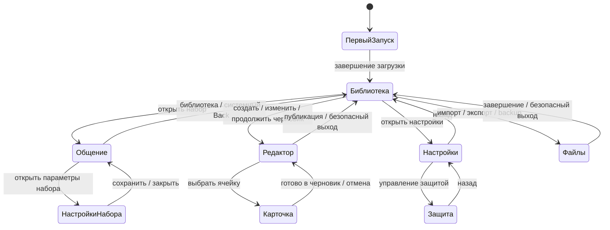

# Ручная приёмка Android на чистом планшете — 8 ноября 2026

Проверяет пользователь. Агент подготавливает среду и записывает замечания;
не меняет код и не выполняет следующие сценарии за пользователя без просьбы.
Выполненная подготовка не означает PASS ручных проверок.

## Стенд

- AVD: `linka_audit_tablet`, serial `emulator-5556`; второй эмулятор не трогаем.
- По явному разрешению пользователя выполнен полный wipe этого AVD;
  до установки пакеты `su.linka.pictures*` отсутствовали.
- Приложение: debug `su.linka.pictures.development`, без тестовых фикстур.
- Исходный commit: `d1493b26edd2651806a9d61305fe62a7a18d5ad1`.
- APK: `app/build/outputs/apk/debug/app-debug.apk`.
- SHA-256 APK: `a903bc27ebe4e353dc3f2b0e02e6a01d7db7728d68437835bb65e5c50f9f5c43`.
- `:app:assembleDebug --offline --max-workers=1`: BUILD SUCCESSFUL.
- Android 15 / API 35, альбомная ориентация 2560×1600, density 320,
  системный масштаб шрифта 1.0, локаль чистого образа `en-US`.
- Чистая установка: Success. SHA-256 установленного `base.apk` совпал с APK выше.
- Приложение открыто на библиотеке. Снимок и UI hierarchy подтверждают семь
  исходных наборов: Болит.linka, Еда.linka, Клавиатура.linka, ХОЧУ.linka,
  Цифры.linka, ШУМЫ ДОМА.linka, цифры.linka. Два варианта «Цифры/цифры»
  зафиксированы как наблюдение стартового состояния, без оценки пользователем.
- Начальный снимок:
  `/private/var/folders/l4/r3plyjwj7pz_nq7zz50x04880000gn/T/opencode/linka-tablet-clean-library-2026-11-08.png`
  (временный локальный файл, не долговременный архив доказательств).

## FSM: основной маршрут

Это модель ручного обхода, а не замена внутренних автоматов приложения.
Стрелка обозначает действие пользователя и ожидаемое состояние.

Если действие защищено: запрос доступа → неверный пароль оставляет действие
запрещённым; успешный вход разрешает явное продолжение, но не запускает запись,
публикацию или восстановление автоматически. Отмена возвращает без изменений.

### Вложенные состояния

| Подсистема | Состояния и обязательные переходы |
|---|---|
| Общение COMPOSE | Пустое → выбор карточки/текст → сообщение → озвучивание → остановлено/завершено. Удаление последнего; очистка → восстановление очистки. Смена страницы/набора и возврат из библиотеки не должны неожиданно терять сообщение. |
| Общение DIRECT | Нажатие карточки → непосредственное произнесение при доступном аудио; отдельная проверка переходов COMPOSE ↔ DIRECT. |
| Редактор | Открыт → изменён → сохранённый черновик → применён. Форма карточки: Готово меняет черновик, не опубликованный набор; Отмена не применяет ввод. Выход с несохранёнными изменениями — только по предусмотренному подтверждению. |
| Прерывание редактора | Работа → фон/системный выбор файла → при необходимости PAUSED → явное продолжение. Возврат в приложение сам не повторяет импорт медиа, запись звука или публикацию. |
| Перенос | Выбор файла/назначения → проверка/подготовка → предпросмотр → отдельное подтверждение → запись → COMPLETED, CANCELLED или FAILED. Эти исходы не смешиваются. |
| Неизвестный исход | UNCONFIRMED — не «ошибка, нажмите повторить». Повтор записи запрещён; сохраняем сообщение и шаги, не пытаемся чинить данные. |

## Порядок ручной проверки

Статусы: `TODO`, `PASS` (подтвердил пользователь), `FAIL` (есть замечание),
`BLOCKED` (нет предусловия). Пока все сценарии — `TODO`.
Для тестовых изменений используем отдельный набор «Приёмка 08.11».
Удаление, замена библиотеки и восстановление выполняются пользователем явно,
после проверки backup; агент самостоятельно их не запускает.

| ID | Переход / что сделать | Ожидаемый результат | Статус |
|---|---|---|---|
| T01 | Первый запуск после wipe; закрыть и открыть приложение | Семь исходных наборов; нет старых пользовательских данных, дублей, зависшей загрузки | TODO |
| T02 | Библиотека → каждый исходный набор → Back | Названия, обложки, карточки и изображения читаемы; возврат работает | TODO |
| T03 | COMPOSE: выбрать несколько карточек, включая повтор одной | Верный порядок сообщения, подписи/миниатюры и выделение; нет случайных двойных действий | TODO |
| T04 | Сообщение: текст, удалить последнее, очистить, восстановить | Каждая команда меняет именно ожидаемый фрагмент; пустое сообщение безопасно | TODO |
| T05 | Сообщение → другая страница → библиотека → тот же/другой набор | Сообщение не исчезает неожиданно; миниатюры доступны после смены набора | TODO |
| T06 | Произнести → остановить; быстрые нажатия; DIRECT ↔ COMPOSE | Звук не накладывается; остановка работает; режимы ведут себя различно и предсказуемо | TODO |
| T07 | Настройки набора: сменить режим и кнопки страниц; закрыть без сохранения | Сохранённое применяется; отменённое не применяется; сообщение не теряется | TODO |
| T08 | Создать «Приёмка 08.11»; название и сетка | Корректный ввод; пустые/недопустимые размеры отклоняются без потери данных | TODO |
| T09 | Карточка CONTENT: подпись, картинка из файла/текста; Готово/Отмена | Предпросмотр и сохранённая карточка совпадают; отмена не публикует изменения | TODO |
| T10 | Карточка: CONTENT → SPACE → EMPTY → CONTENT | Поля и поведение соответствуют типу; скрытие полей не теряет ввод при обратном переключении | TODO |
| T11 | Карточка: синтез, аудиофайл, запись; разрешить/отказать микрофону | Предпрослушивание/стоп работают; отказ и отсутствие локального голоса объясняются, не ведут к зависанию | TODO |
| T12 | Страницы: добавить, переставить, удалить; сетка и перестановка ячеек | Правильная страница/ячейка; заполненные данные не теряются молча при уменьшении сетки | TODO |
| T13 | «Вводить без пробела»; сохранить набор → открыть в общении | Режим ввода и опубликованные карточки соответствуют сохранённому; нет дубля набора | TODO |
| T14 | Изменить набор → выйти → продолжить черновик; перезапустить приложение | Черновик восстанавливается; до применения опубликованный набор неизменён; удалить черновик ≠ удалить набор | TODO |
| T15 | Переименовать набор; отменить удаление; затем удалить только тестовый набор | Подтверждение называет объект; отмена безопасна; удалённые примеры не воскресают после перезапуска | TODO |
| T16 | Общие настройки: масштаб, контраст, тема, язык речи; недопустимый ввод | Элементы доступны; корректные настройки сохраняются согласно UI; тема явно только на сеанс; язык речи не подменяет язык интерфейса | TODO |
| T17 | Защита: установить, неверный/верный пароль, сменить, отменить/подтвердить отключение | Важные действия защищены, общение доступно; секреты скрыты; после фона нужен новый доступ | TODO |
| T18 | Экспорт тестового набора → импорт новым набором; отмена файлового диалога | Переносятся страницы/картинки/звук; предпросмотр до записи; отмена без изменения библиотеки | TODO |
| T19 | Импорт с заменой; повреждённый/неподходящий файл | Отдельное подтверждение называет заменяемый набор; ошибка понятна, исходная библиотека сохранна | TODO |
| T20 | Backup с черновиком/медиа/настройками → изменить тестовые данные → restore | Предупреждение о незашифрованном архиве и замене библиотеки; после подтверждения всё восстановлено, список обновлён | TODO |
| T21 | Точка восстановления: возврат; отменить/подтвердить её удаление | Возврат и удаление различимы, требуют подтверждения; числа объектов правдивы | TODO |
| T22 | Фон/возврат и перезапуск из общения, редактора, выбора файла, предпросмотра переноса | Нет скрытого повторного действия; понятный выход/продолжение; устойчивые данные сохранены | TODO |
| T23 | Портрет ↔ альбом; клавиатура; большой системный шрифт; длинные подписи/сообщение | Не перекрыты кнопки/футер, доступны прокрутка и Back; нет обрезанных важных действий | TODO |
| T24 | RU/EN системы; светлая/тёмная тема и контраст; TalkBack | Нет смеси служебных строк, элементы подписаны, фокус и порядок чтения пригодны для использования | TODO |

Для T06/T11: если на чистом образе нет локального TTS-голоса или микрофон не
доступен, проверку успешного звука отмечаем BLOCKED, а не PASS. Отдельно проверяем
корректное объяснение недоступности. Установку голоса согласовываем отдельно.

## Как фиксируем замечания

Каждое замечание получает `OBS-001`, `OBS-002`, … и привязку к Txx.
Сохраняем слова пользователя, шаги, ожидание, факт, ориентацию/режим,
воспроизводимость и ссылку на снимок, если он сделан.
Не называем предположение подтверждённой причиной.

Приоритет: P0 — потеря данных/обход защиты/невозможность общения;
P1 — не работает основной сценарий; P2 — неудобство/вёрстка/текст.
Статусы замечаний: OPEN → FIXED → RETEST → CLOSED; исправления — отдельное поручение.

| ID | Проверка | Замечание пользователя и шаги | Ожидание / факт | Приоритет | Статус / доказательства |
|---|---|---|---|---|---|

Замечаний пока нет; ручная приёмка не начата.

## Что этот прогон не доказывает

- Обновление поверх старой production-версии и миграция реальных данных:
  нужен отдельный прогон на другом стенде без wipe, с синтетической старой библиотекой.
- Подписанный release, публикация, требования магазина, ABI/16 KB и полный test/lint gate.
- Физический планшет, аппаратные аудио/микрофон, другие версии Android, телефоны и iOS.
- Конфликт записи, нехватка диска и UNCONFIRMED без отдельного управляемого сценария;
  опасные сбои не вызываем во время ручной приёмки произвольно.

## Продолжение: замечания и реализация

В этой сессии пользователь сформулировал OBS-001–009. Их согласованный объём,
коммиты, результаты проверок и открытые blockers записаны в
[журнале реализации](manual-review-implementation-2026-11-08.md).
Этот исходный список T01–T24 не помечается автоматически PASS после изменения кода:
нужна повторная ручная приёмка новой сборки. Старые стартовые наборы пока не заменены;
состав нового комплекта утверждён, пользователь предоставит собственные записи.
