# Визуальный разбор экранов LINKa «Картинки»

Номера соответствуют оригинальным PNG в `screenshots/phone/` и `screenshots/tablet/`.
Каждое изображение просмотрено визуально; дерево интерфейса использовалось только для навигации.
Приоритеты: **P1** — мешает распознаванию, общению или безопасному действию; **P2** — усложняет сценарий; **P3** — визуальная согласованность.
Рекомендации ниже — материал для будущего редизайна, не выполненные изменения.

## 01. Первый запуск: конфиденциальность

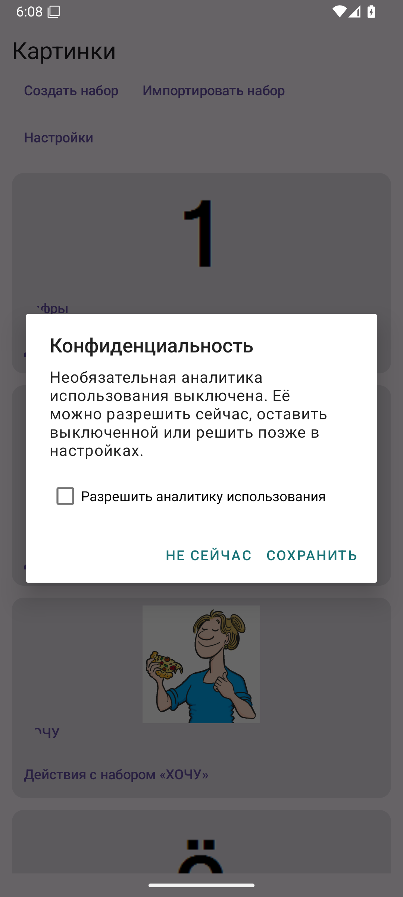
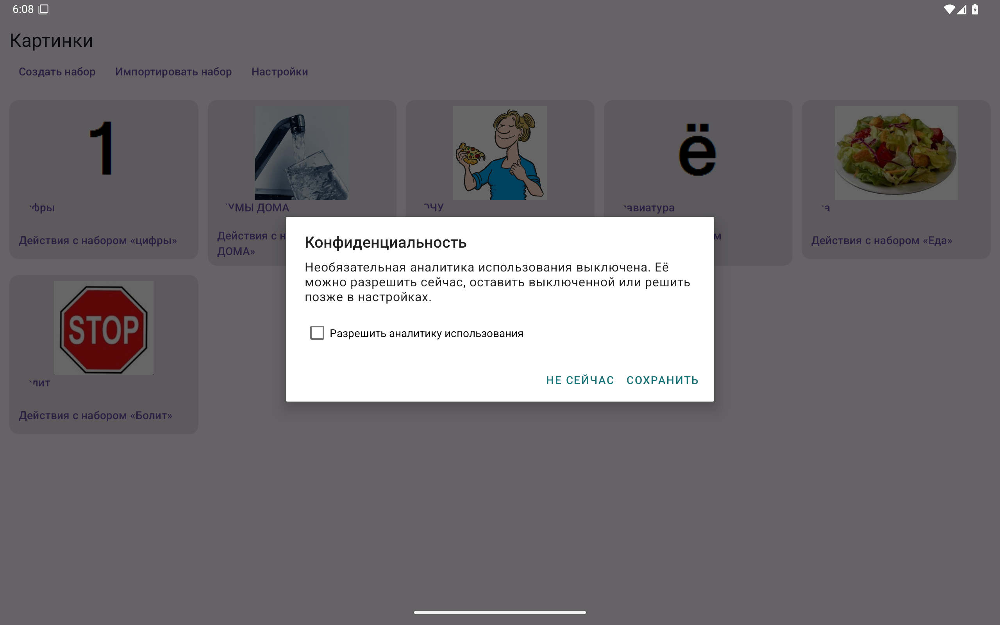

**Путь:** первый запуск → автоматическое уведомление.

- **Телефон:** длинный абзац занимает большую часть модального окна; одинаковые текстовые действия «Не сейчас» и «Сохранить» плохо объясняют разницу между отказом и сохранением выключенной аналитики.
- **Планшет:** текст читается свободнее, но между описанием, чекбоксом и действиями много несвязанного пустого пространства. Уведомление заслоняет библиотеку до знакомства с приложением.
- **Общее, P2/P3:** прямоугольный белый системный диалог с бирюзовыми прописными кнопками визуально не связан с округлыми сиреневыми компонентами библиотеки. Положительный момент: аналитика не отмечена по умолчанию.
- **Для редизайна:** сократить вводный текст, явно назвать вариант продолжения без аналитики, согласовать оформление диалога с приложением; не превращать согласие в обязательное условие работы.

## 02. Библиотека наборов

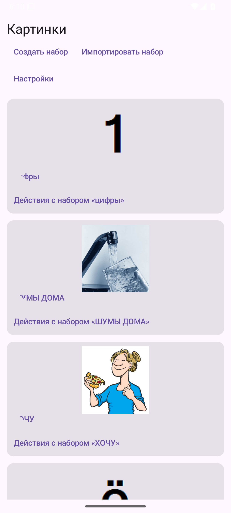
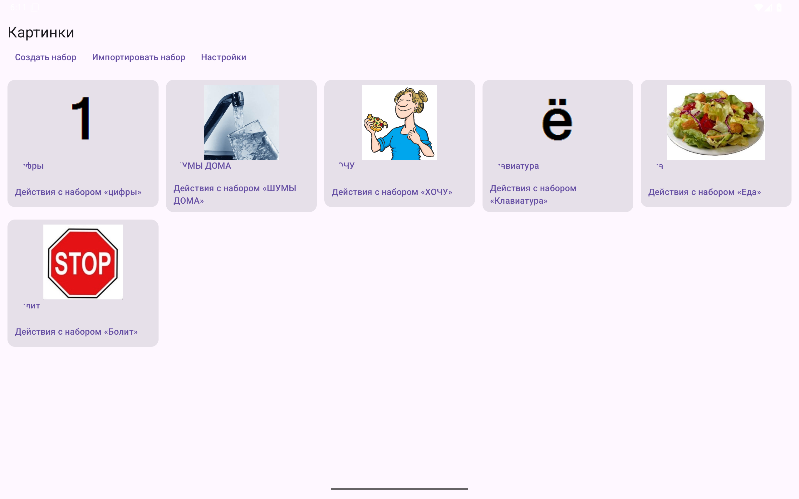
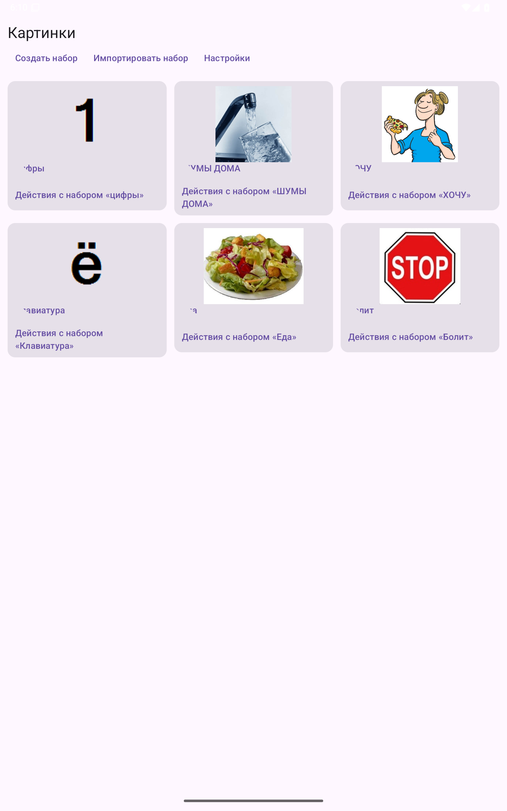

**Путь:** закрыть уведомление первого запуска.

- **Телефон, P1:** начала названий под обложками срезаны/перекрыты: «цифры», «ШУМЫ ДОМА», «ХОЧУ» не отображаются целиком. Дефект виден и после смены графического режима эмулятора; причина по скриншоту не установлена.
- **Телефон, P2:** одна колонка очень широких плиток с небольшими изображениями: видно только три полных набора. Длинная строка «Действия с набором …» конкурирует с самим названием. «Настройки» переносятся в отдельную строку и увеличивают высоту шапки.
- **Планшет, P1/P2:** срезанные названия повторяются. В альбомной сетке пять колонок; длинные действия переносятся и делают плитки разной высоты. Обложки отличаются масштабом и стилем, названия менее заметны, чем вспомогательные действия.
- **Планшет, портрет:** три колонки и большая пустая нижняя область; дополнительная ширина не решает иерархию внутри плитки.
- **Оба, P1:** белые часы и системные значки почти неразличимы на светлом фоне статус-бара.
- **Для редизайна:** сначала восстановить целые названия и контраст системной панели; затем сделать единую компактную плитку с читаемым названием, предсказуемой зоной открытия и отдельным компактным меню. Не менять пользовательские изображения ради единообразия.

## 03. Меню действий с набором

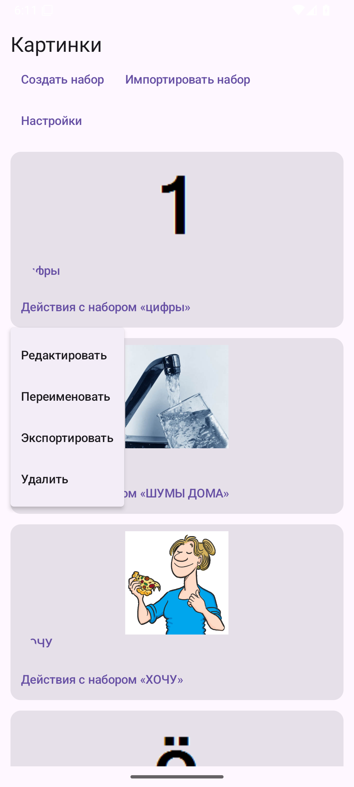
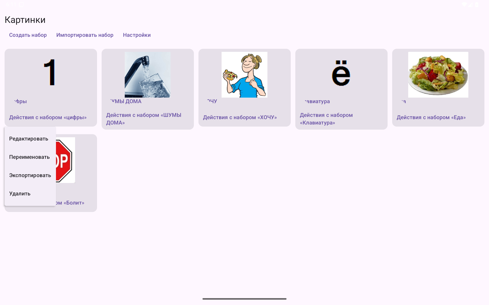

**Путь:** библиотека → «Действия с набором „цифры“».

- **Телефон:** выпадающее меню перекрывает следующий набор; без затемнения и выделения выбранной плитки связь с исходным набором слабеет.
- **Планшет:** меню компактно относительно всей сетки, но визуально оказывается поверх «Болит», хотя открыто для «цифры». Название объекта внутри меню не повторено.
- **Общее, P1/P2:** «Удалить» оформлено так же, как редактирование и экспорт; нет разделителя или визуального предупреждения. Иконок и дополнительного контекста нет, всё приходится читать.
- **Для редизайна:** явно привязать меню к выбранной плитке, отделить разрушительное действие и сохранить текстовые подписи, а не заменять всё неоднозначными иконками.

## 04. Переименование набора

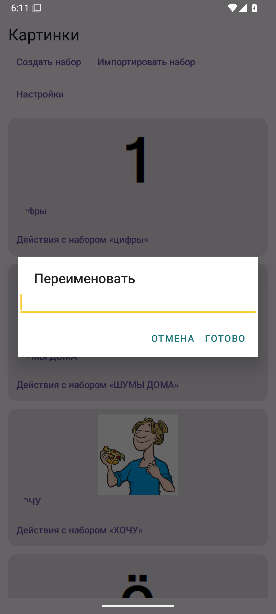
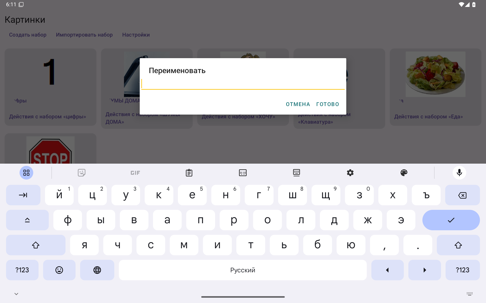

**Путь:** меню набора → «Переименовать».

- **Телефон, P2:** поле пустое вместо текущего имени; нет постоянной подписи или примера. Поле почти упирается в края окна, тогда как заголовок и кнопки имеют другие отступы. В этой конфигурации аппаратной клавиатуры экранная клавиатура на снимке не показана.
- **Планшет, P2:** при открытой клавиатуре диалог остаётся доступным, но его широкое пустое поле не содержит ни исходного имени, ни инструкции. Клавиатура занимает почти половину экрана.
- **Общее, P3:** жёлтая линия активного ввода, бирюзовые действия и сиреневая библиотека выглядят как разные системы оформления. «Готово» не называет результат операции.
- **Для редизайна:** показывать текущее имя, подписать поле «Название набора», выровнять отступы и назвать подтверждение «Переименовать»; ошибки и запрет пустого имени показывать возле поля.

## 05. Подтверждение удаления набора

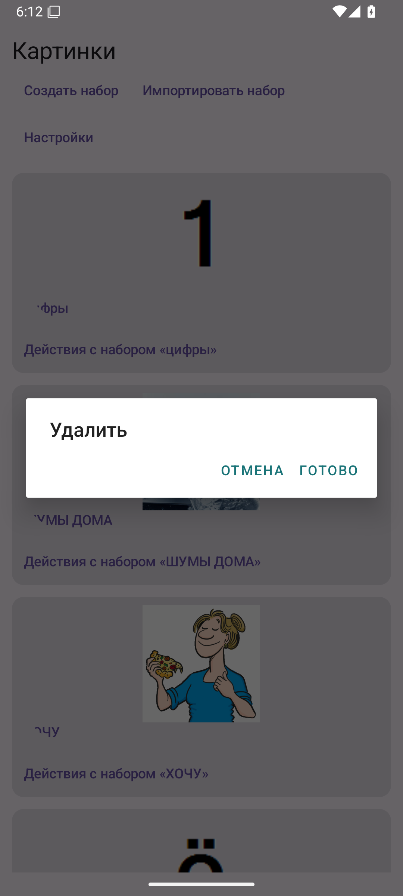
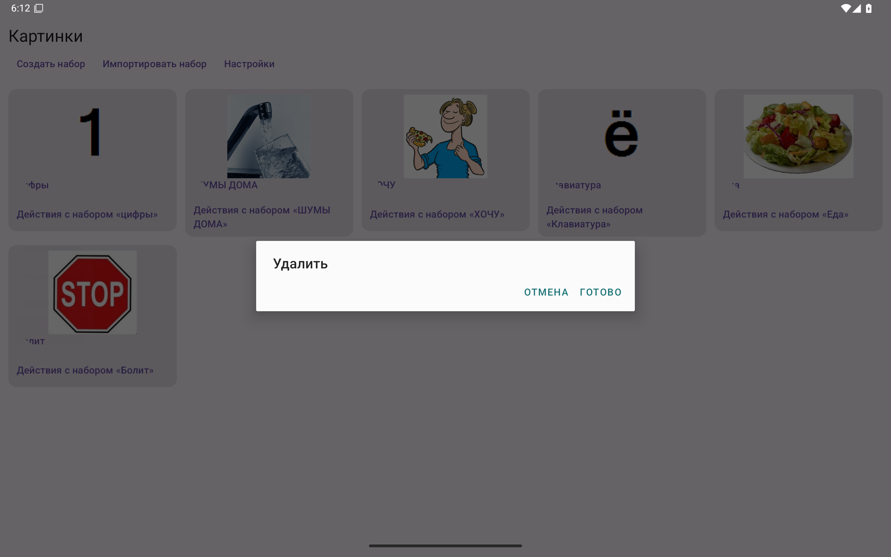

**Путь:** меню набора → «Удалить». Удаление не подтверждалось.

- **Телефон, P1:** только заголовок «Удалить» и кнопки «Отмена» / «Готово»: неизвестно, что именно будет удалено, и насколько обратимо действие.
- **Планшет, P1:** та же проблема, усиленная очень широким практически пустым диалогом. Исходный набор на затемнённом фоне не выделен.
- **Общее:** опасное подтверждение визуально не отличается от безопасного ввода текста; «Готово» скрывает смысл разрушительного действия.
- **Для редизайна:** «Удалить набор „цифры“?», короткое описание последствий и явная кнопка «Удалить набор» с опасным акцентом. Не ограничиваться одним цветом предупреждения.

## 06. Экспорт: системное сохранение файла

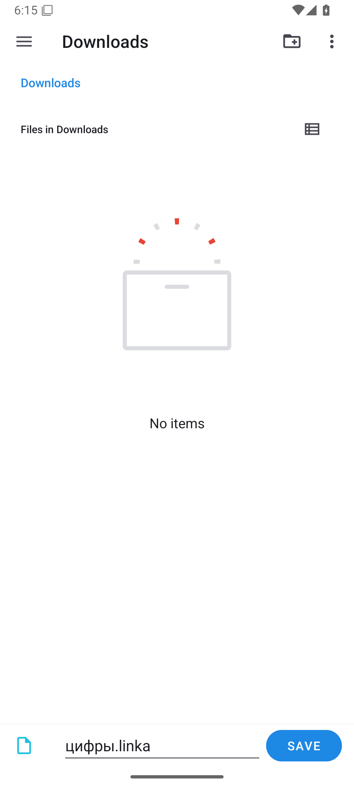
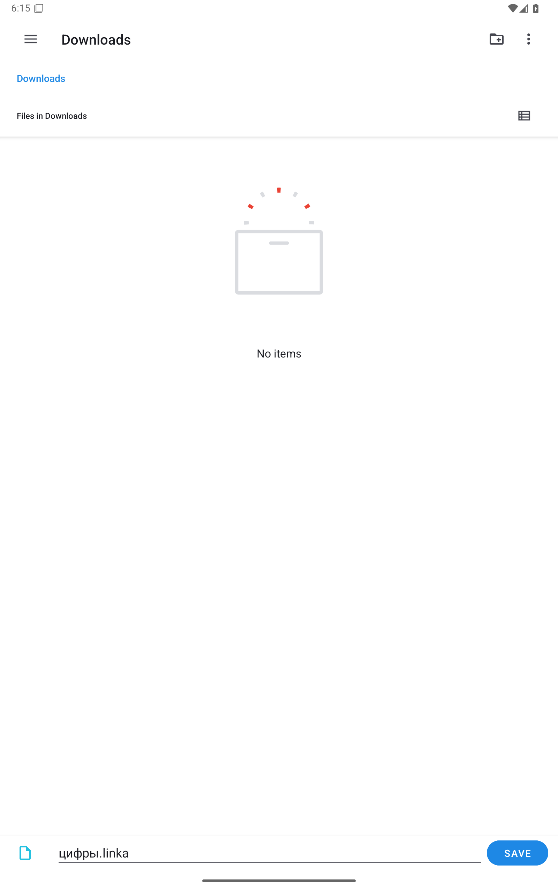

**Путь:** меню набора → «Экспортировать».

- **Телефон:** имя `цифры.linka` заполнено, действие SAVE видно внизу. Однако экран не объясняет, что это резервная копия одного набора, а не всех данных приложения.
- **Планшет:** системный экран в портрете растягивает поле имени на всю ширину, оставляя почти всю высоту пустой. Он выглядит иначе, чем альбомная библиотека.
- **Общее, P2:** интерфейс Android на английском, приложение на русском — следствие разных языков ОС и приложения в тестовой среде, не отсутствие русского перевода самого приложения. На редизайн системного окна приложение не должно претендовать.
- **Для редизайна:** сохранить штатный безопасный выбор файла; до перехода кратко объяснить назначение `.linka`, после него показать понятное подтверждение экспорта.

## 07. Импорт: системный выбор файла

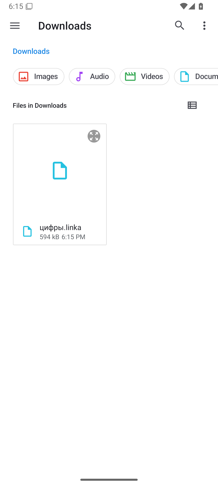
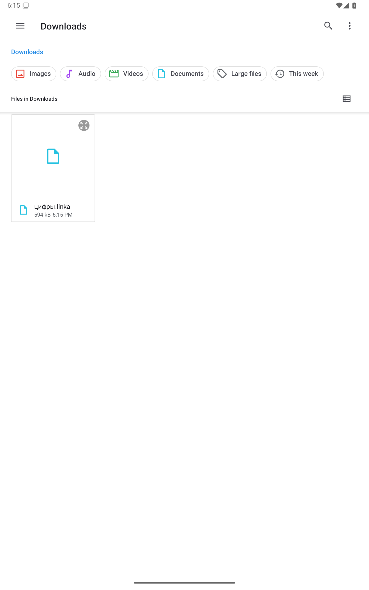

**Путь:** библиотека → «Импортировать набор». На устройствах предварительно экспортирован тестовый `цифры.linka`.

- **Телефон:** в системном файловом окне доступны фильтры Images / Audio / Videos, хотя пользователь ищет набор. Обложки и пояснения типа `.linka` нет, только стандартная иконка документа.
- **Планшет:** файл занимает одну небольшую плитку в большой пустой области; нет связи с визуальным образом набора в библиотеке.
- **Общее, P2:** из окна неясно, какой файл поддерживает приложение. Системные фильтры — не собственный интерфейс LINKa.
- **Для редизайна:** объяснить ожидаемый формат перед открытием Android picker и показывать имя/обложку после выбора; не заменять системный доступ к файлам самодельным проводником.

## 08. Подтверждение импорта

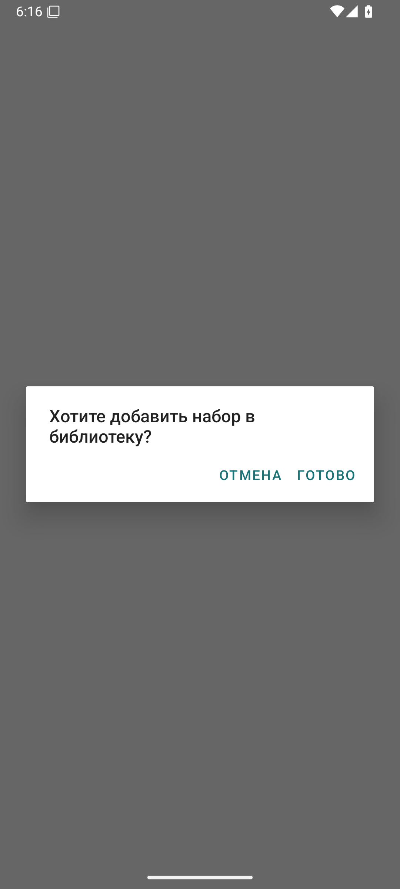
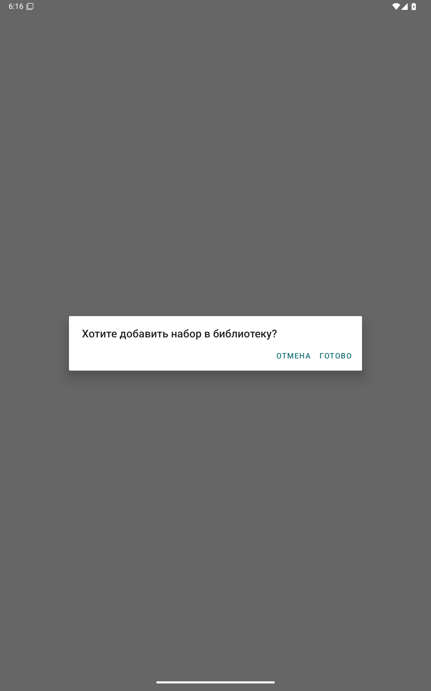

**Путь:** выбрать `цифры.linka` в файловом окне.

- **Телефон, P2:** вопрос «Хотите добавить набор в библиотеку?» расположен на полностью сером фоне, без имени выбранного файла и без его предварительного просмотра.
- **Планшет, P2:** узкое по высоте окно посреди большой серой поверхности не даёт дополнительной информации, несмотря на доступное место.
- **Общее:** «Готово» следует заменить конкретным действием «Импортировать»; добавить имя набора, не выдавая непроверенное содержимое за успешно импортированное.

## 09. Конфликт имён: замена набора

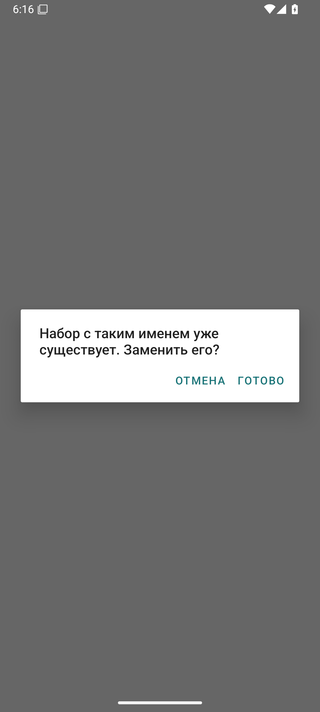
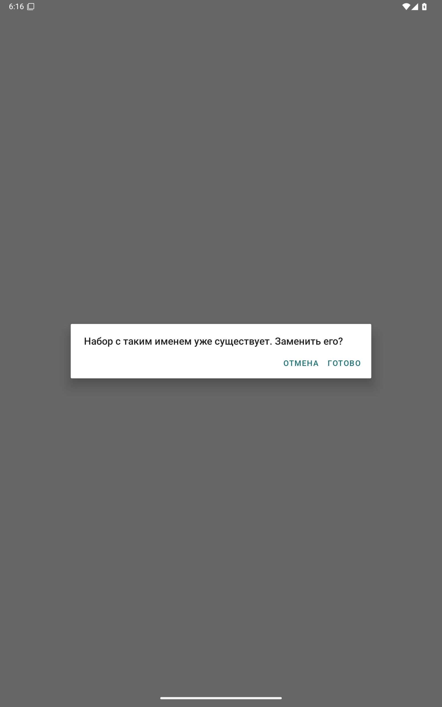

**Путь:** подтвердить импорт уже существующего `цифры.linka`. Замена отменена.

- **Телефон, P1:** предупреждение говорит «с таким именем», но самого имени не показывает. «Готово» не сообщает, что пользователь разрешает замену данных.
- **Планшет, P1:** тот же риск; длинное однострочное предупреждение и одинаковые кнопки не выделяют опасную операцию.
- **Для редизайна:** назвать существующий набор, объяснить замену содержимого и подписать подтверждение «Заменить набор». Не скрывать предупреждение ради сокращения числа окон.

## 10. Общие настройки

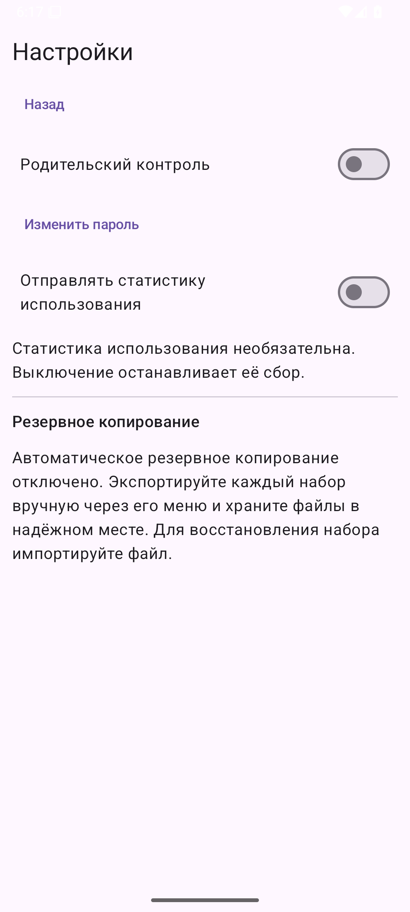
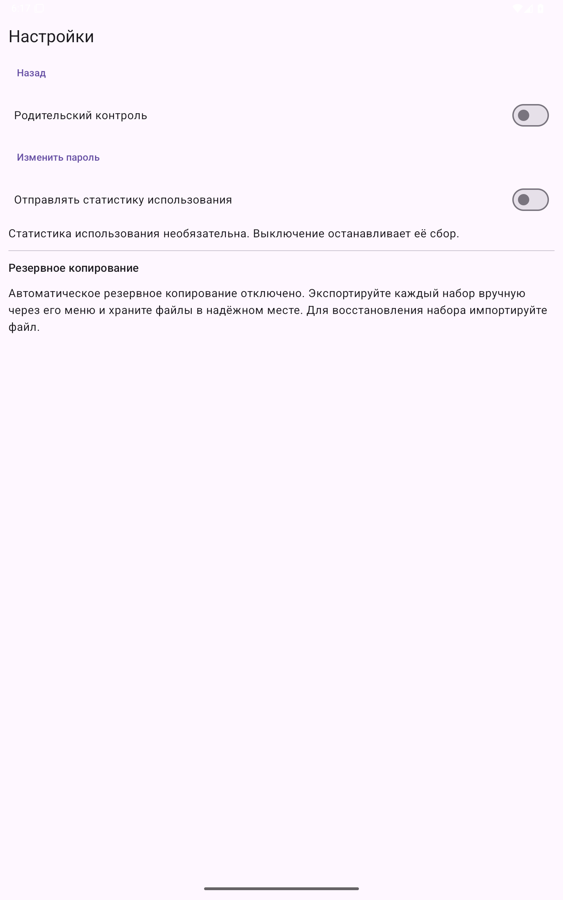

**Путь:** библиотека → «Настройки», родительский контроль первоначально выключен.

- **Телефон, P2:** родительский контроль и пароль визуально не объединены; не объяснено, какие действия будут защищены. Текст про резервное копирование длинный, но не сопровождается переходом к экспорту.
- **Планшет, P2:** строки растянуты на всю ширину, переключатели далеко от подписей; длинные текстовые строки труднее читать. Почти вся нижняя часть экрана пуста.
- **Общее, P3:** «Назад» занимает отдельную строку вместо компактной навигационной панели. Повторяется проблема белых значков статус-бара.
- **Для редизайна:** сгруппировать «Защита», «Конфиденциальность», «Сохранность наборов»; ограничить ширину текста на планшете и добавить короткое описание родительского режима. Не обещать автоматический backup, которого нет.

## 11. Установка / изменение пароля

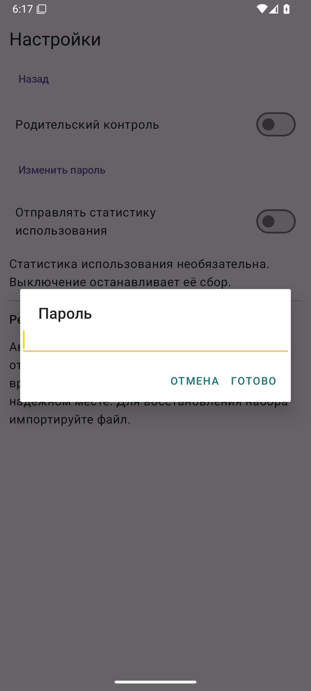
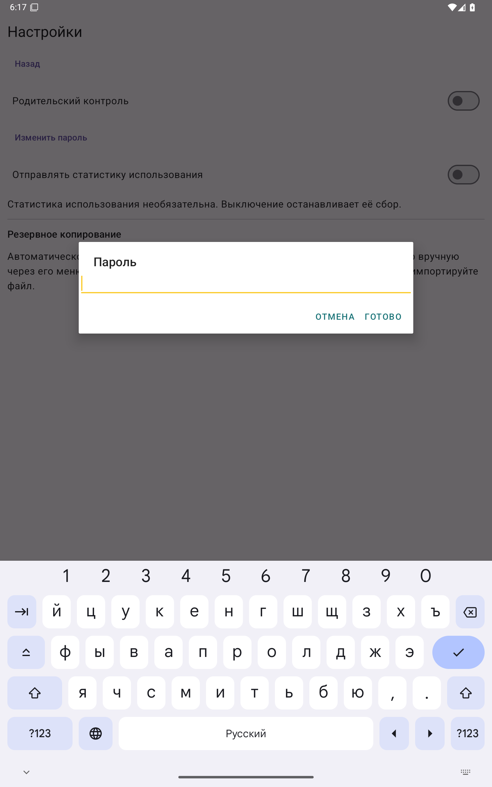

**Путь:** настройки → «Изменить пароль».

- **Телефон:** заголовок «Пароль» не отличает установку нового пароля от проверки существующего. Нет видимой подсказки о назначении и возможности показать введённое значение.
- **Планшет:** экранная клавиатура видна, но дополнительное место не используется для инструкции; поле без постоянной подписи растянуто почти до краёв окна.
- **Общее, P2:** оформление и отступы не совпадают с настройками. Нет подтверждения повторным вводом или иного видимого способа проверить опечатку перед сохранением.
- **Для редизайна:** явный заголовок «Задать родительский пароль», подписанное поле, показ/скрытие и понятное объяснение последствий; сохранить маскирование по умолчанию.

## 12. Родительская проверка доступа

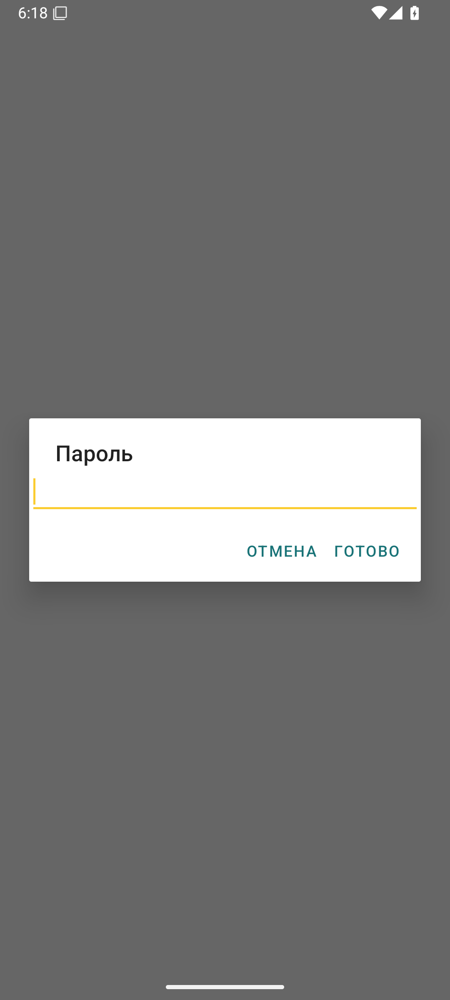
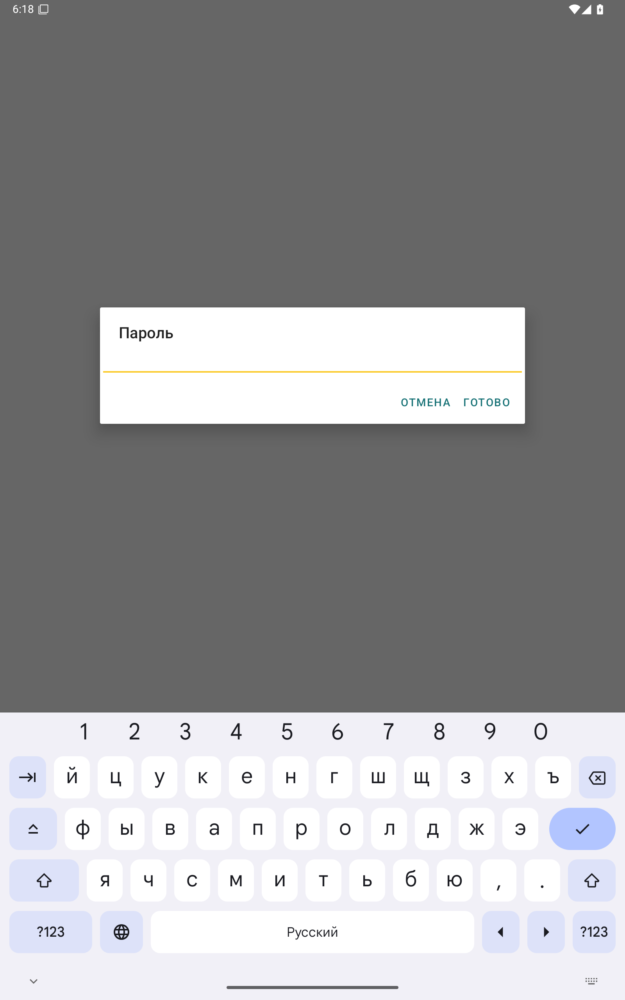

**Путь:** установить тестовый пароль → включить контроль → вернуться в библиотеку → открыть настройки.

- **Телефон, P2:** полностью серый фон лишает пользователя контекста; диалог с заголовком «Пароль» не объясняет, зачем он появился.
- **Планшет, P2:** повторяет форму создания пароля и потому неотличим от неё по назначению. Клавиатура занимает заметную часть экрана.
- **Для редизайна:** «Введите родительский пароль для открытия настроек», действие «Открыть настройки»; ошибка должна оставаться рядом с полем, а не быть только исчезающим сообщением. После съёмки контроль выключен через штатный ввод тестового пароля.

## 13. Доска «ХОЧУ»: пустая фраза

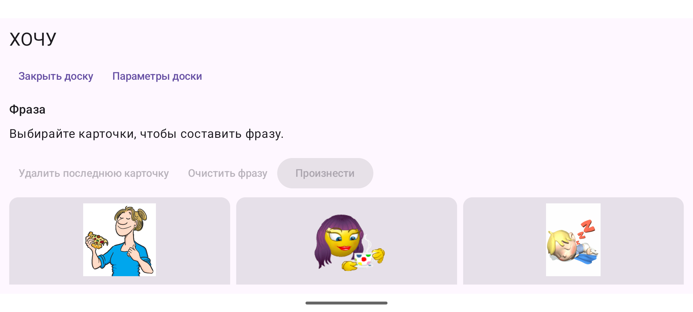
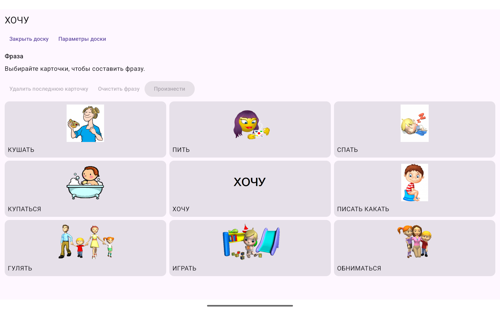

**Путь:** библиотека → «ХОЧУ».

- **Телефон, P1:** принудительная альбомная ориентация оставляет мало высоты. Заголовок, навигация, подпись «Фраза», инструкция и отключённые действия занимают большую часть экрана; видна только часть первого ряда, подписи карточек уходят ниже края.
- **Планшет, P2:** все девять карточек помещаются, но изображения невелики относительно широких плиток; большие интервалы в шапке ослабляют связь фразы и сетки.
- **Общее:** текстовые административные действия конкурируют с коммуникационным сценарием. Разностильность встроенных изображений заметна, но узнаваемые пользователем символы нельзя массово заменять только ради красоты.
- **Для редизайна:** компактная шапка; отдельная постоянная зона фразы и произнесения; сетка в оставшейся области, не под длинной прокручиваемой шапкой.

## 14. Доска: выбранная карточка во фразе

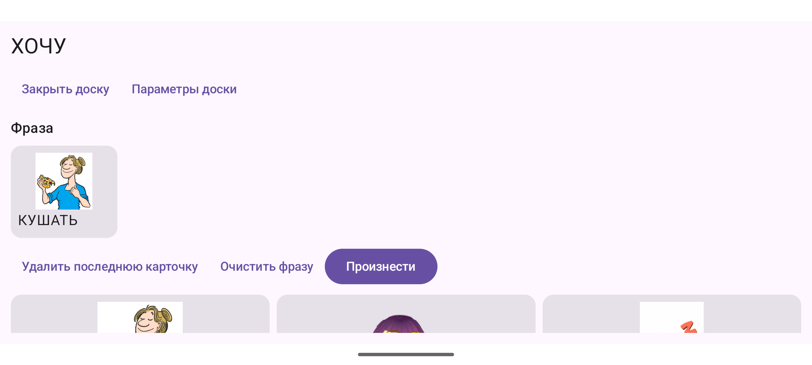
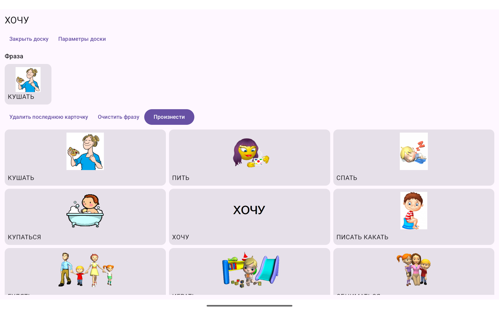

**Путь:** на доске «ХОЧУ» выбрать «КУШАТЬ».

- **Телефон, P1:** добавление одной карточки увеличивает шапку настолько, что от сетки остаются только верхушки изображений. Для следующего выбора нужна прокрутка.
- **Планшет, P2:** новая строка фразы сдвигает нижний ряд к краю и частично прячет подписи. Почти вся ширина строки фразы остаётся пустой.
- **Общее:** кнопка «Произнести» корректно получает заполненный акцент, но нет устойчивой отдельной зоны набранной фразы.
- **Для редизайна:** ограничить высоту фразы, сохранить её горизонтальный просмотр и всегда доступное произнесение; добавление карточки не должно выталкивать всю сетку.

## 15. Доска после прокрутки

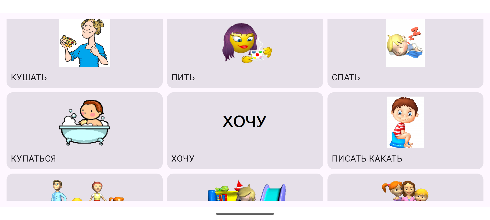
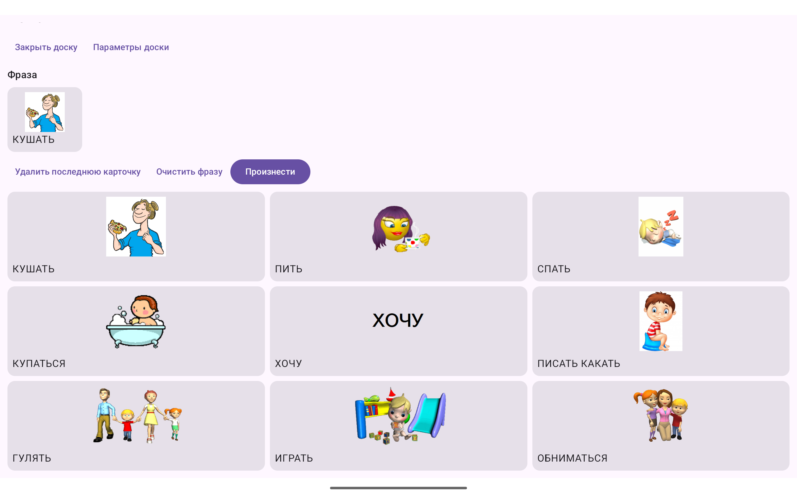

**Путь:** с выбранной карточкой прокрутить сетку вверх.

- **Телефон, P1:** карточки и подписи становятся видны, но фраза, очистка и произнесение полностью исчезают. Пользователь выбирает слова в одном положении, а озвучивает в другом.
- **Планшет, P2:** небольшая прокрутка позволяет показать нижние подписи, но обрезает заголовок. Шапка и сетка двигаются как один длинный документ.
- **Для редизайна:** независимо прокручиваемая сетка и закреплённые коммуникационные действия. Не уменьшать карточки до трудных для нажатия размеров только ради размещения всего содержимого.

## 16. Параметры доски

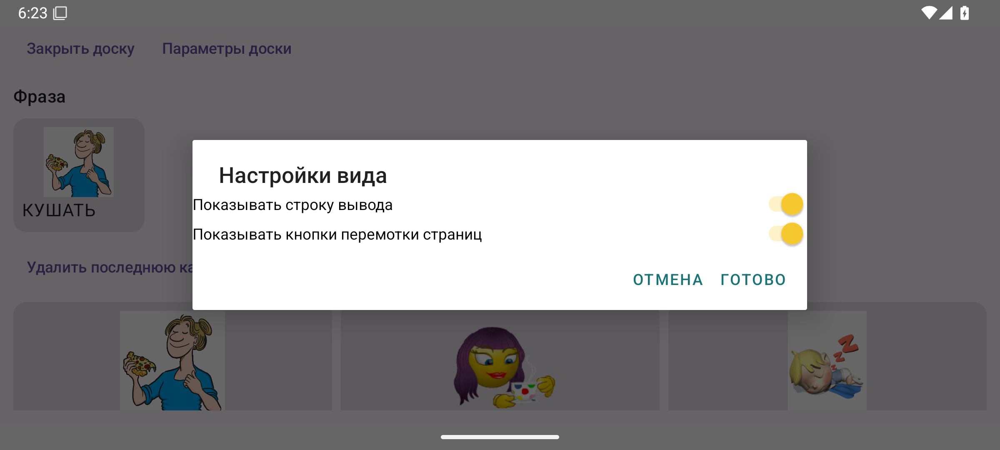
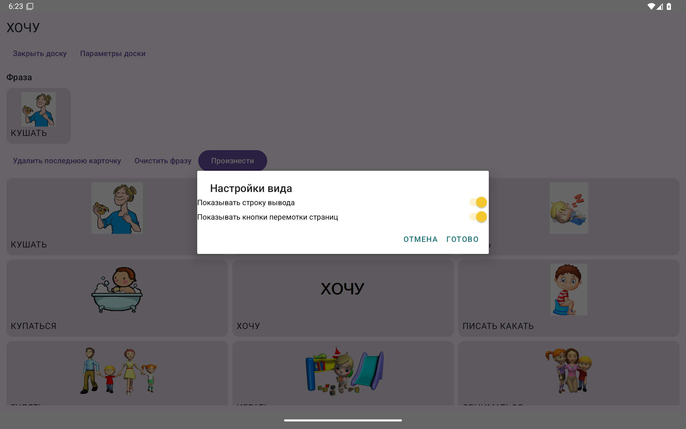

**Путь:** доска → «Параметры доски».

- **Телефон, P2:** заголовок «Настройки вида», ссылка входа «Параметры доски», термин «строка вывода» вместо видимой на доске «Фразы». Длинная подпись «кнопки перемотки страниц» усложняет простую настройку.
- **Планшет:** подписи слева почти касаются края диалога, переключатели далеко справа; визуальное выравнивание не совпадает с заголовком.
- **Общее, P3:** жёлтые старые переключатели отличаются от сиреневых в общих настройках, подтверждение снова «Готово».
- **Для редизайна:** единые компоненты и термины, понятное объяснение «Составлять фразу» / «Произносить карточку сразу», отдельное название для навигации по страницам.

## 17. Прямое произнесение карточки

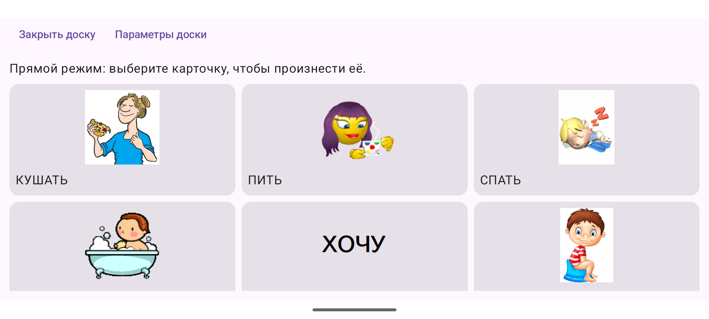
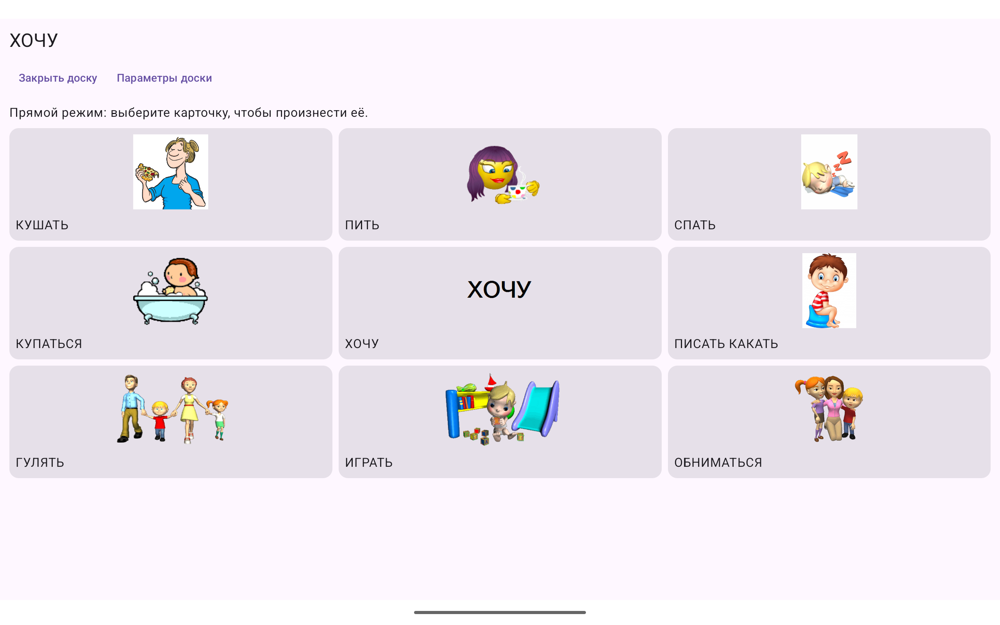

**Путь:** параметры → выключить строку вывода → подтвердить. Телефон сохраняет положение прокрутки после предыдущего состояния.

- **Телефон:** без строки фразы доступно значительно больше карточек, но нижний ряд всё равно обрезан, а название доски оказалось выше видимой области.
- **Планшет:** вся сетка помещается; разница с режимом составления фразы выражена главным образом одной строкой текста, без компактного устойчивого обозначения режима.
- **Общее, P2:** название переключателя не объясняет, что его выключение меняет поведение касания на немедленное произнесение.
- **Для редизайна:** явно обозначать активный режим и объяснять результат переключения, сохраняя простой доступ к карточкам.

## 18. «цифры»: первая страница

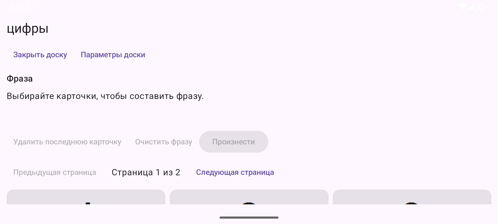
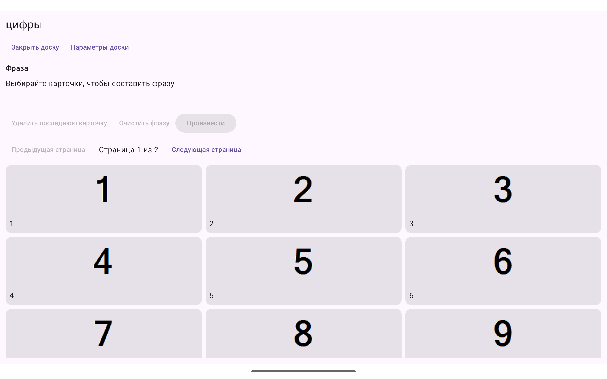

**Путь:** библиотека → «цифры».

- **Телефон, P1:** пагинация добавляет ещё одну строку; теперь почти не видно даже изображений первого ряда.
- **Планшет, P2:** первый и второй ряды читаются, третий частично скрыт. Один символ дублируется крупной картинкой и мелкой подписью, а широкая плитка преимущественно пуста.
- **Для редизайна:** компактная постоянная пагинация рядом с сеткой, предсказуемый размер символов; не смешивать логическую страницу и длинную вертикальную прокрутку без явного обозначения.

## 18b. «цифры»: вторая страница

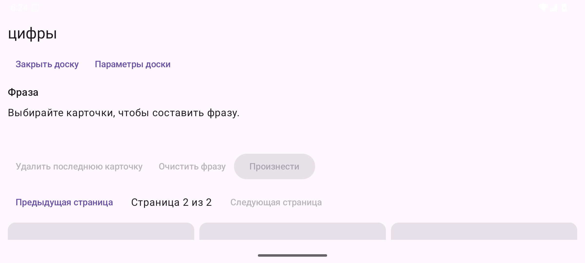
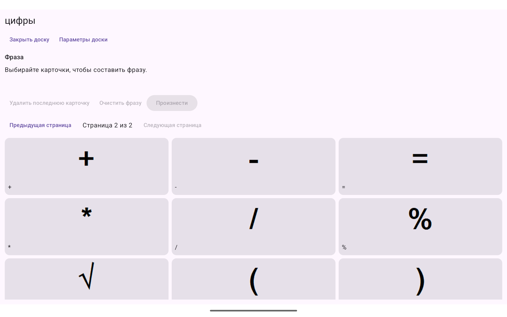

**Путь:** «Следующая страница».

- **Телефон, P1:** счётчик меняется на «2 из 2», а содержимое новой страницы практически не видно. Проверить результат переключения без прокрутки невозможно.
- **Планшет:** математические знаки читаемы, но последняя строка с корнем и скобками срезана; отсутствует постоянная видимость всех логических ячеек страницы.
- **Для редизайна:** переход должен сразу открывать полезное содержимое новой страницы, не только менять счётчик в большой шапке.

## 19. Доска «ШУМЫ ДОМА»

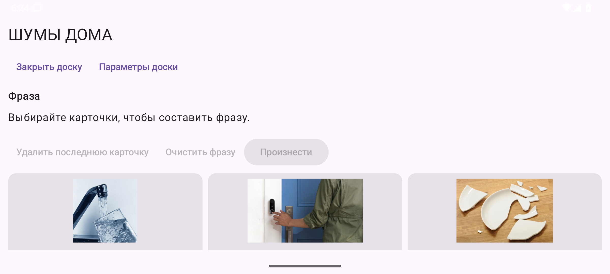
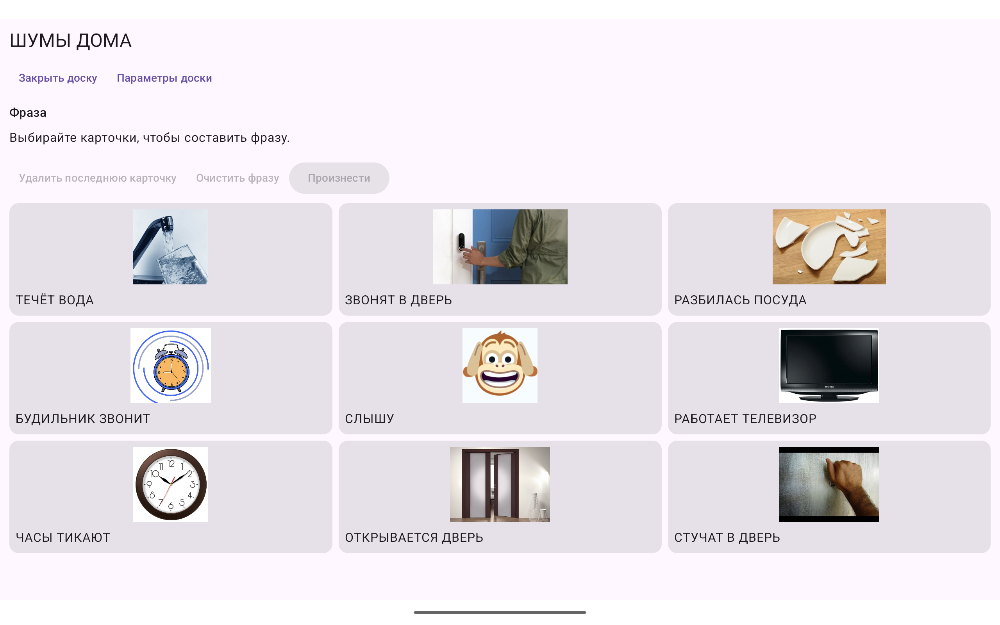

**Путь:** библиотека → «ШУМЫ ДОМА».

- **Телефон, P1:** видны три фотографии без подписей; определить смысл изображения двери без текста сложнее, а остальные шесть карточек скрыты.
- **Планшет, P2:** все подписи доступны, но фотографии, мультяшный будильник и эмодзи имеют разные фоны и масштаб. Изображения внутри широких плиток сравнительно малы.
- **Для редизайна:** гарантировать подпись в видимой части каждой карточки, унифицировать контейнер и масштабирование, не подменяя пользовательское содержание.

## 20. Доска «Клавиатура»: первая страница

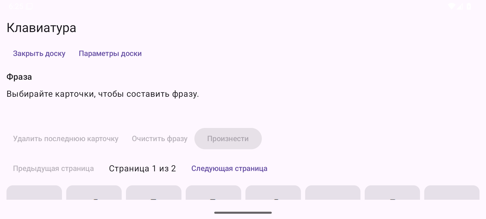
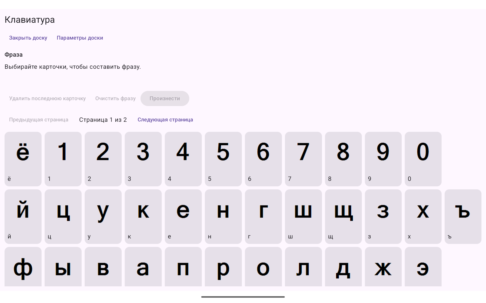

**Путь:** библиотека → «Клавиатура».

- **Телефон, P1:** ни одного читаемого символа при открытии: весь первый экран занят управлением. Узкая доступная ширина также меняет перенос ячеек по сравнению с планшетом.
- **Планшет, P2:** клавиши чрезмерно высокие, буква/цифра дублируется подписью, нижние ряды уходят за край. Большая шапка мешает функции набора текста.
- **Для редизайна:** рассматривать клавиатуру как плотную коммуникационную сетку, а не набор фотокарточек; сохранить знакомый порядок символов и пользовательскую раскладку.

## 20b. «Клавиатура»: вторая страница

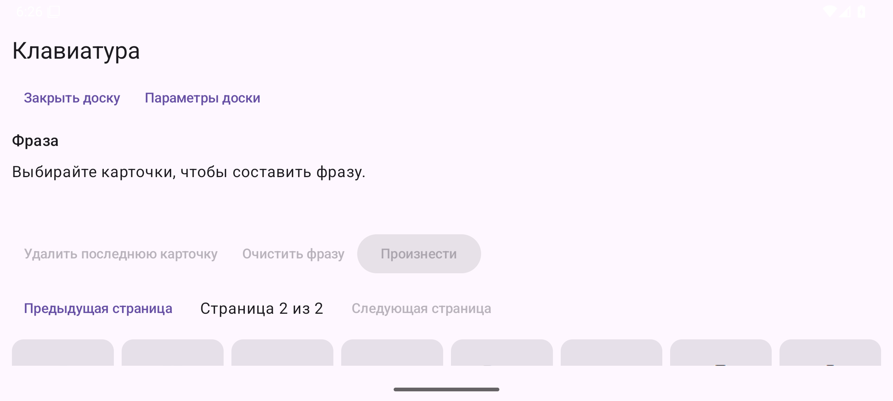
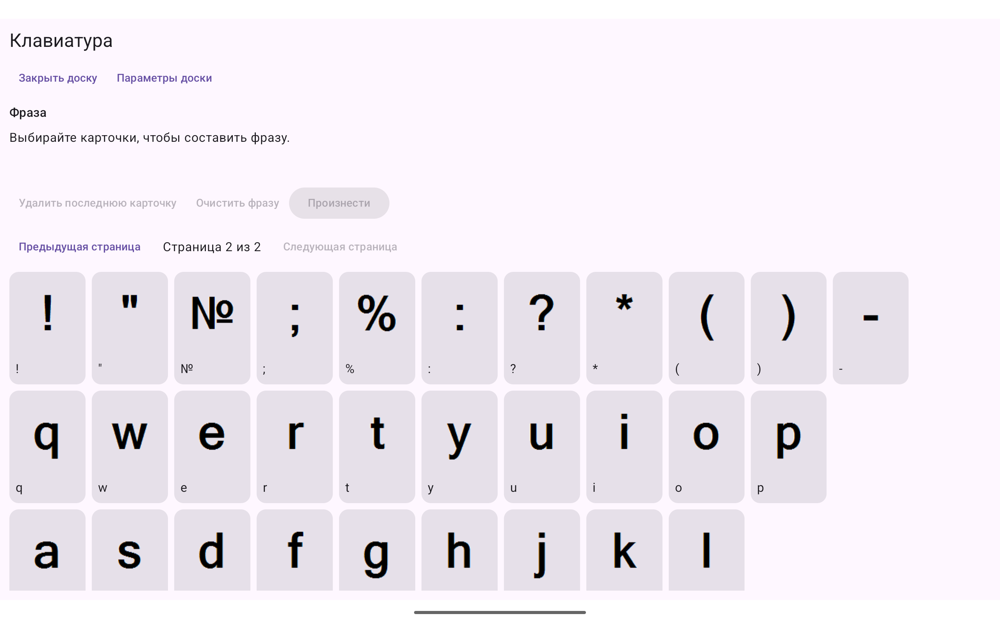

- **Телефон, P1:** после перехода виден только счётчик страницы, символы вновь скрыты ниже края.
- **Планшет:** доступны знаки и часть английских букв, но неполные строки и разные пустые промежутки делают раскладку труднее для сканирования.
- **Для редизайна:** показывать, какая раскладка/группа символов открыта, не заставляя угадывать её по номеру «2»; высоту клавиш согласовать с реальной высотой окна.

## 20c. «Клавиатура»: прокрутка второй страницы

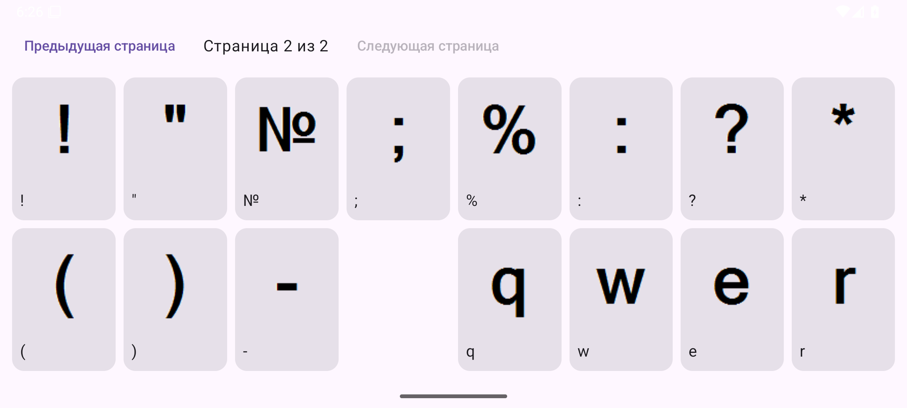
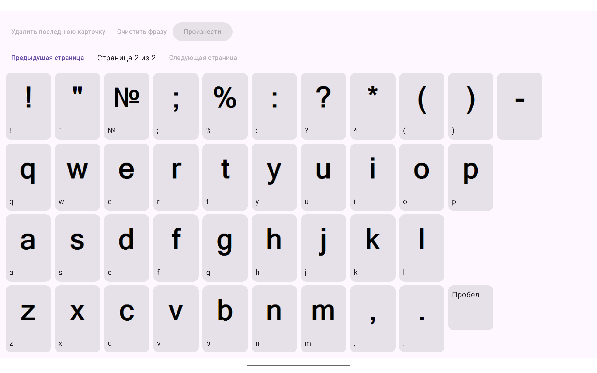

- **Телефон, P1:** в видимой области только знаки и начало латинского ряда; поле набранной фразы и произнесение исчезли. Изменение числа визуальных колонок переносит раскладку и мешает запоминанию позиций.
- **Планшет, P2:** нижние ряды и «Пробел» становятся видны, но сам «Пробел» короче остальных клавиш, а шапка фразы уже выше экрана.
- **Для редизайна:** не допускать конфликта между чтением набранного текста и доступом к клавишам; сохранять понятную устойчивую раскладку и отдельную заметную клавишу пробела.

## 21. Доска «Еда»

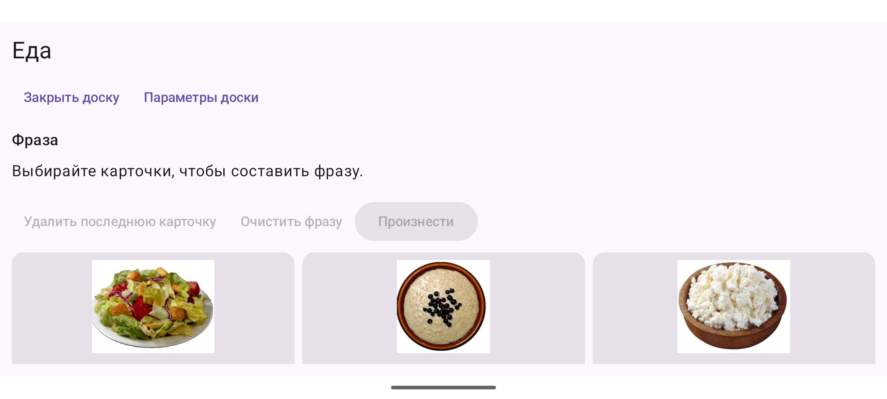
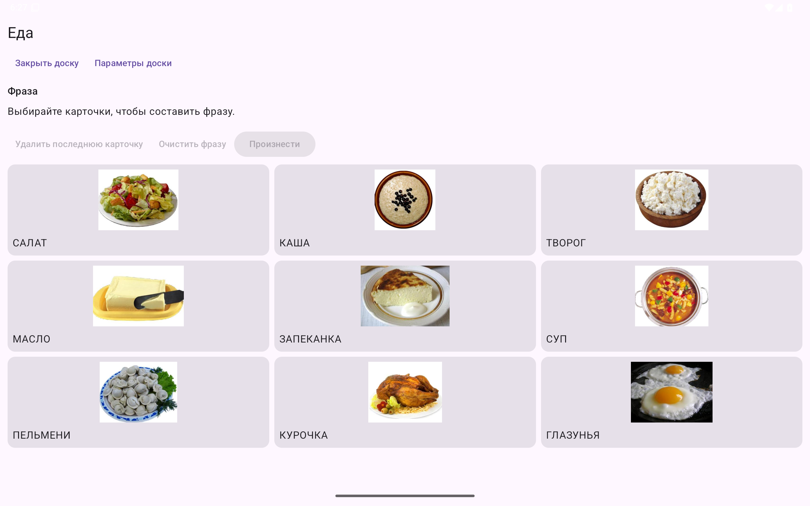

- **Телефон, P1:** на первом экране видны только три фотографии без названий. Похожую еду нельзя уверенно различать по подписи без прокрутки.
- **Планшет, P2:** все девять названий помещаются, однако фотографии неодинаковы по фону, масштабу и площади объекта; контейнеры значительно шире изображений.
- **Для редизайна:** сохранять название возле фотографии на любом размере окна; нормализовать область превью, не обрезая важные части еды.

## 22. Доска «Болит»

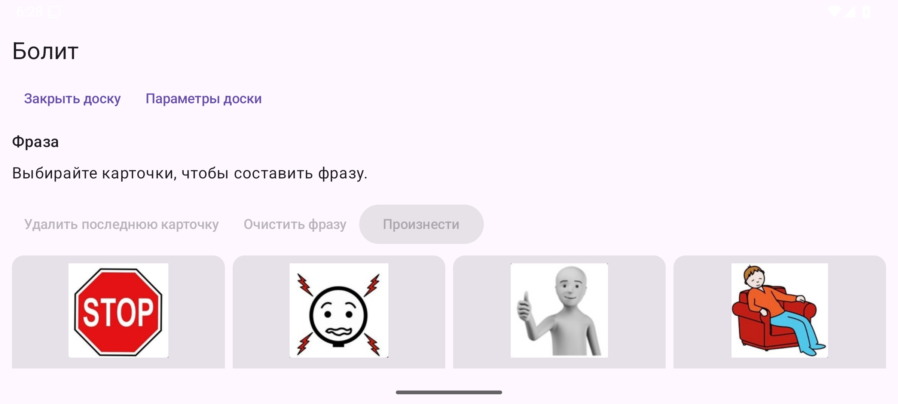

- **Телефон, P1:** видны только первые четыре изображения без подписей; «Голова», «Рука», «Живот» и другие карточки находятся ниже. Для сообщения о боли это особенно существенная задержка.
- **Планшет, P2:** все 12 карточек и подписи доступны. Понятный красный STOP выделяется, но иллюстрации частей тела имеют неодинаковый масштаб и смешанные стили.
- **Для редизайна:** обеспечить быстрый доступ к существующим карточкам и постоянное произнесение. Не менять знакомые пользователю позиции и изображения без отдельной проверки с пользователями AAC.

## 23. Создание набора: имя

**Путь:** библиотека → «Создать набор».

- **Телефон, P2:** приложение уже развернулось в альбомную ориентацию ради простого поля ввода; за диалогом видны отключённые элементы редактора и индикатор загрузки.
- **Планшет:** окно имени и клавиатура доступны, но фон редактора перегружает простой первый шаг.
- **Общее:** поле без собственной подписи/примера, оформление старого диалога; подтверждение «Готово» не объясняет переход в редактор.
- **Для редизайна:** компактный ввод названия с понятным следующим шагом; не показывать незавершённый редактор как будто готовый к работе.

### 23b. Телефон: полноэкранный режим экранной клавиатуры

При работе с именем в альбомной ориентации Android IME открыл полноэкранный ввод с кнопкой DONE, полностью скрыв диалог и контекст. Это системный режим клавиатуры, не отдельный экран LINKa. **P2:** простой ввод имени превращается в переключение между двумя подтверждениями; при редизайне проверить ориентацию формы и поведение клавиатуры. На планшете аналогичный полноэкранный режим в этом обходе не возник.

## 24. Редактор пустого набора

**Путь:** задать тестовое имя `Audit`.

- **Телефон, P1:** карточек совсем не видно. Экран занят именем, действиями, многострочными настройками количества строк/столбцов и переключателем пробелов; даже пагинация срезана.
- **Планшет, P2:** сетка доступна, но каждая пустая ячейка повторяет длинное «Добавить или изменить карточку». Двенадцать одинаковых предложений создают шум вместо понятных слотов.
- **Общее:** «Уменьшить: Строки» и «Увеличить: Строки» выглядят как технические подписи вместо компактного счётчика. Отрицательная формулировка настройки пробелов требует дополнительного осмысления.
- **Для редизайна:** сетка — главная рабочая область; настройки расположения — компактная панель/отдельный блок; пустой слот — понятное «Добавить» с доступным текстовым описанием.

### 24b. Телефон: редактор после прокрутки

Сетка становится доступна, но имя, сохранение и параметры исчезают. Все слоты заполнены одинаковым длинным текстом в две строки; нижний ряд срезан. **P1/P2:** закрепить сохранение и навигацию, дать сетке самостоятельную область прокрутки.

## 25. Создание страницы: подтверждение

**Путь:** редактор → «Новая страница». Подтверждение отменено.

- **Телефон:** «Подтвердить создание страницы» — канцелярский заголовок без объяснения, какой будет результат; окно перекрывает и без того маленькую рабочую область.
- **Планшет:** то же практически пустое окно, не использующее место для номера/назначения страницы.
- **Общее, P2:** дополнительный шаг с «Готово» не добавляет информации.
- **Для редизайна:** если подтверждение действительно нужно, назвать действие «Создать страницу» и объяснить следующий шаг; иначе рассмотреть прямое обратимое добавление, не удаляя защиту важных данных.

## 26. Редактор новой карточки: верхняя часть

**Путь:** редактор пустого набора → первая свободная ячейка.

- **Телефон, P1:** диалог сжимается до узкой вертикальной полосы (видимый контент около 48 dp); «Стандартная карточка» разбивается на один-два символа в строке. Подписи обрезаны, назначение формы практически невозможно понять.
- **Планшет, P1:** та же узкая полоса посреди большого экрана. Даже подпись кнопки выбора изображения рисуется вертикально; большая площадь планшета не используется.
- **Общее:** видна опечатка «Название картлчки». Часть предусмотренных типов/действий не появляется в доступной области формы и дереве интерфейса.
- **Для редизайна:** первоочередно восстановить нормальную адаптивную ширину и полную доступность полей. Для сложной карточки рассмотреть полноценную форму вместо вложенного узкого диалога. Никаких исправлений во время аудита не внесено.

## 27. Редактор новой карточки: прокрутка к медиа и удалению

- **Телефон, P1:** после прокрутки подписи кнопок всё ещё идут вертикальными буквами; серое воспроизведение занимает большую высоту, а значок корзины остаётся без видимого названия карточки. Чтобы добраться до «Отмена» и «Готово», требовалась дальнейшая прокрутка.
- **Планшет, P1:** много пустого места внутри узкой полосы, текст выбора/воспроизведения обрезан; увеличение экрана не помогает чтению формы.
- **Для редизайна:** нормальная ширина, явные группы «Изображение» и «Звук», закреплённые действия формы. Пустая новая карточка не должна предлагать удаление как основной заметный символ.

## 28. Выбор изображения: Android Photo Picker

**Путь:** форма карточки → кнопка выбора изображения. На чистых эмуляторах фотографий нет.

- **Телефон:** штатная нижняя панель развёрнута почти на весь альбомный экран; понятны закрытие и вкладки Photos / Albums, но не видно имени редактируемой карточки.
- **Планшет:** большая пустая поверхность с коротким сообщением об отсутствии фото; это корректное состояние пустой медиатеки, не ошибка загрузки приложения.
- **Общее, P2:** язык picker зависит от английской ОС, а не русского языка приложения. Системное объяснение ограниченного доступа к выбранным фото полезно и должно сохраниться.
- **Для редизайна:** перед переходом обозначать редактируемую карточку и доступные способы получения изображения; не рисовать собственный аналог системного picker.

## 29. Удаление карточки: подтверждение

**Путь:** корзина в форме новой карточки. Удаление отменено.

- **Телефон, P1:** второе модальное окно поверх узкого первого; заголовок «Удалить» не называет объект, кнопка «Готово» не обозначает удаление.
- **Планшет, P1:** та же потеря контекста. Видна корзина исходной формы, но не содержание карточки, к которой относится подтверждение.
- **Для редизайна:** конкретное «Удалить карточку …?» и понятные последствия; показывать действие удаления только там, где объект уже существует.

## 30. Сохранение набора: подтверждение

**Путь:** выйти из формы карточки без изменений → «Сохранить». Подтверждение отменено.

- **Телефон, P2:** после явной кнопки сохранения требуется ещё одно «Готово». Имени `Audit` в диалоге нет, результата сохранения не описано.
- **Планшет, P2:** практически пустой широкий диалог использует тот же шаблон, что и удаление/замена.
- **Для редизайна:** не делать каждое сохранение неинформативным двухшаговым действием; отдельно сохранить обязательное предупреждение при конфликте или замене данных.

## 31. Выход из редактора / отказ от черновика

**Путь:** редактор → «Назад».

- **Телефон, P1:** текст «Выйти из сохранения» не объясняет, будут ли изменения сохранены или потеряны. «Готово» двусмысленно.
- **Планшет, P1:** тот же опасный языковой дефект: по виду окно почти идентично подтверждению сохранения непосредственно перед ним.
- **Для редизайна:** «Выйти без сохранения?» с явными вариантами «Продолжить редактирование» / «Выйти без сохранения»; при необходимости отдельное «Сохранить и выйти». В обходе отброшен только созданный для съёмки пустой черновик `Audit`.

## 32. Редактор существующего набора

**Путь:** библиотека → меню «ХОЧУ» → «Редактировать».

- **Телефон, P1:** даже у заполненного набора на первом экране не видно ни одной редактируемой карточки. Не показано явное отличие просмотра от редактирования, кроме панели действий и параметров.
- **Планшет, P2:** часть заполненной сетки видна, но нижний ряд за пределами экрана; настройки строк/столбцов занимают несоразмерно много места. Карточки внешне близки к карточкам режима общения.
- **Для редизайна:** чётко обозначить режим редактирования, закрепить сохранение и сделать карточки основной рабочей областью. Штатный набор в обходе не перезаписывался.

### 32b. Прокрутка существующего набора

- **Телефон, P1/P2:** нижние карточки теперь доступны, но вся панель сохранения исчезла; верхний ряд остался только в виде подписей. Без шапки сетку трудно отличить от режима общения.
- **Планшет:** все девять карточек помещаются после прокрутки, но сохранение также выше экрана. Большая шапка, а не размер самой сетки, мешала первоначальному просмотру.
- **Для редизайна:** постоянная маркировка режима и закреплённая панель действий; прокручивать содержимое сетки, а не весь редактор целиком.

## 33. Редактор существующей карточки

**Путь:** редактор «ХОЧУ» → «КУШАТЬ».

- **Телефон, P1:** наличие текста, картинки и аудио не устраняет сжатие формы. Видимый текст имени обрезан до окончания, превью сильно уменьшено; кнопки выбора и воспроизведения по-прежнему вертикальные.
- **Планшет, P1:** форма также остаётся узкой полосой; поле с названием не позволяет одновременно прочитать слово, а изображение существенно меньше, чем на фоне редактора.
- **Общее:** дефект не ограничен пустой карточкой. Воспроизведение становится активным при существующем аудио, но визуальной формы обычной ширины не появляется.
- **Для редизайна:** проверить ширину и измерение формы как с отсутствующим, так и с загруженным медиа; обеспечить читаемые подписи и устойчивую компоновку независимо от содержимого. Изменения существующей карточки не сохранялись.

## 34. Пустая библиотека

**Путь:** на двух специально созданных тестовых эмуляторах штатно удалить шесть автоматически установленных демонстрационных наборов. Это не пользовательские устройства и не пользовательские наборы.

- **Телефон, P2:** простой абзац под шапкой сообщает об отсутствии наборов, но не выделяет следующий шаг. Почти вся альбомная область пуста; две равнозначные ссылки наверху требуют самостоятельного выбора сценария.
- **Планшет, P2:** тот же небольшой текст в левом верхнем углу большой пустой поверхности. Нет визуального объединения инструкции с действиями «Создать» / «Импортировать».
- **Для редизайна:** компактное объяснение и заметное основное действие «Создать набор», вторичное «Импортировать .linka». Не выдавать исчезновение наборов за штатный первый запуск: в этом приложении первоначально уже есть демонстрационные наборы.

## Что не удалось визуально проверить

Это границы покрытия, а не утверждение, что соответствующих функций нет:

- В формах новой и существующей карточки после прокрутки не удалось получить доступ через видимый UI к другим типам карточек, генерации изображения из текста, генерации звука и записи микрофона. Поэтому их диалоги, разрешение на микрофон и состояние активной записи **не имеют подтверждённых скриншотов**. Отдельный редизайн этих состояний по исходникам не выдумывался.
- Не создавалось повреждённое состояние сохранённого родительского пароля ради экрана восстановления: такой экран нельзя считать пройденным по обычному пользовательскому маршруту.
- Не моделировались нехватка диска, повреждённые архивы, аварийное завершение приложения и все кратковременные сообщения об ошибках/загрузке. Исчезающие сообщения не подменены статичными макетами.
- Не проверялись TalkBack, увеличенный системный шрифт, тёмная тема, другие версии Android и физические устройства. Из скриншота нельзя подтвердить удобство моторного доступа, реальный контраст по стандарту или качество звука.
