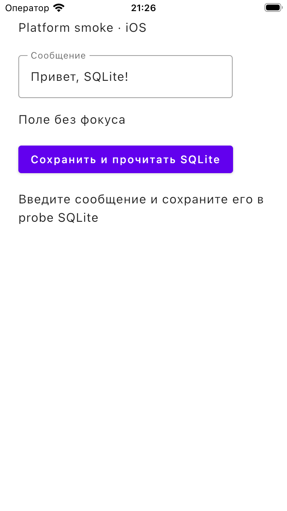

# G1: частичный iOS runtime smoke

4 ноября 2026 года, COORD. Это **не G1 PASS** и не приёмка iOS14.

## Артефакт и среда

- Изолированная ветка `implementation/p01-platform-probe`, исходный app/framework из `595061a`, Android-config follow-up `c7eb3a2`, native test/report commit `dedb578`.
- Воспроизводимые команды, assertions, history и hashes: `git show dedb578:docs/development/platform-probe.md`. Код probe пока не интегрирован в основную implementation-ветку.
- Новый собственный simulator `linka_platform_probe_ios`: iPhone SE3, iOS26.5, UDID `1074CF6C-3AF6-4DF3-A330-5F9013437F3E`. Чужие симуляторы/данные не использованы. Загрузка ожидалась через `simctl bootstatus -b`, не sleep.
- Установлен/запущен только `su.linka.pictures.platformprobe`, executable SHA256 `44970b73826b7c4adbfe0d585ffdc4cf960a12d3f0d01f0c33fdd5b2f342146e`.

## Actual results



PNG визуально просмотрен: общий экран, Unicode-текст, поле, метка фокуса, SQLite-кнопка и начальное состояние отрисованы. Это startup, **не** доказательство нажатия кнопки/ввода/callback. SHA256 PNG `5ec9546980c1d8edb54ae787e5db326afce15475873d91438c5a578de9ba8bf4`.

Дополнительно собран и выполнен `iosApp/NativeSQLiteCheck.swift` из probe-ветки: тот же Kotlin `ProbeDatabase` и реальный bundled SQLite iOS driver, собственный временный UUID-файл, write→close→reopen→read, кавычки/Unicode/emoji и замена пустой строкой. Оба этапа exit0, actual output:

```text
PASS: native SQLite write/close/reopen/read, Unicode, quotes and replacement
```

Harness binary SHA256 `09ea25e0f648af9d1201c761fc802c9e0b962373b194f53e38ce0c7c120bd3ed`, Mach-O minos14.0, реальное выполнение **26.5**. ICU data-only warning при линковке сохранён, метаданные не переписаны.

## Открыто

Нет iOS14 runtime/physical devices, UI-ввода/фокуса/активации/callback, VoiceOver/AAC и полного аудио/файлового стека. Сохраняется явно названный availability-case frame-rate API в CMP1.9.3; weak import и modern startup не доказывают все guarded paths на14. `simctl io` не предоставляет tap, idb/Maestro не установлены; native host permissions не запрашивались и не обходились.

Собственные simulator и probe app оставлены для продолжения. Reset/erase, shutdown чужих сред, profiles/signing, установка SDK/Xcode и изменение production не выполнялись.
