# Визуальный разбор LINKa покажи 1.4

Только заново снятая **1.4 / versionCode 5**, исходники тега `v1.4`. Идентификация и ограничения сборки — в [README](README.md). Каждый PNG просмотрен визуально. Текстовое дерево использовалось для навигации, а не вместо просмотра изображений.

**P1** — читаемость/доступ к общению или риск неверного разрушительного действия; **P2** — затруднение сценария; **P3** — согласованность оформления. Это приоритеты будущего редизайна, не список внесённых изменений.

## 01. Конфиденциальность при первом запуске

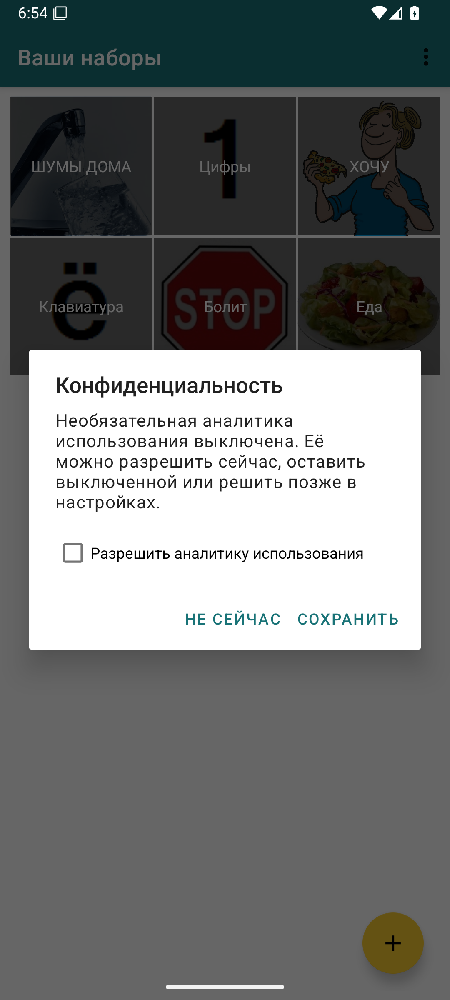
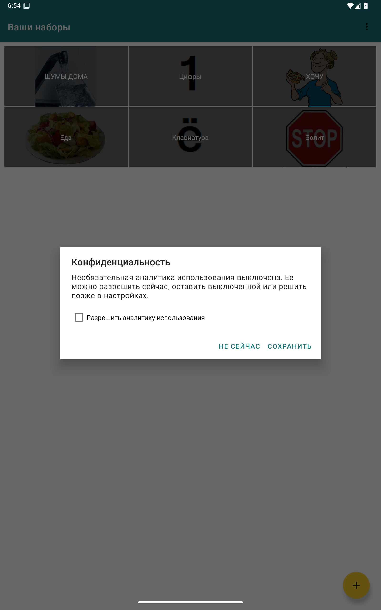

**Путь:** первый запуск чистой установки.

- **Телефон, P2:** длинный абзац и длинная подпись чекбокса требуют чтения ещё до первого взаимодействия с карточками. «Не сейчас» и «Сохранить» плохо объясняют разницу при выключенном чекбоксе.
- **Планшет:** диалог читабельный, но поля и действия разнесены большим пустым пространством; он заслоняет библиотеку вместо знакомства с ней.
- **Для редизайна:** короткий текст и явное продолжение без аналитики; сохранить отсутствие согласия по умолчанию. Нельзя объединять обязательное начало общения с обязательным согласием на аналитику.

## 02. Библиотека: портрет

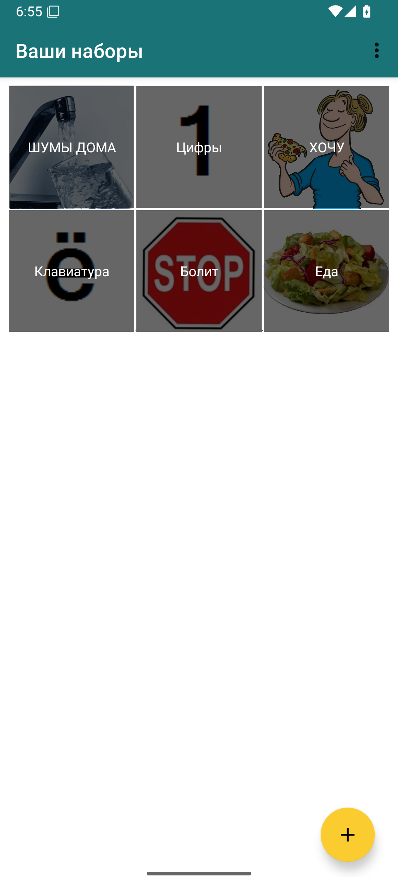
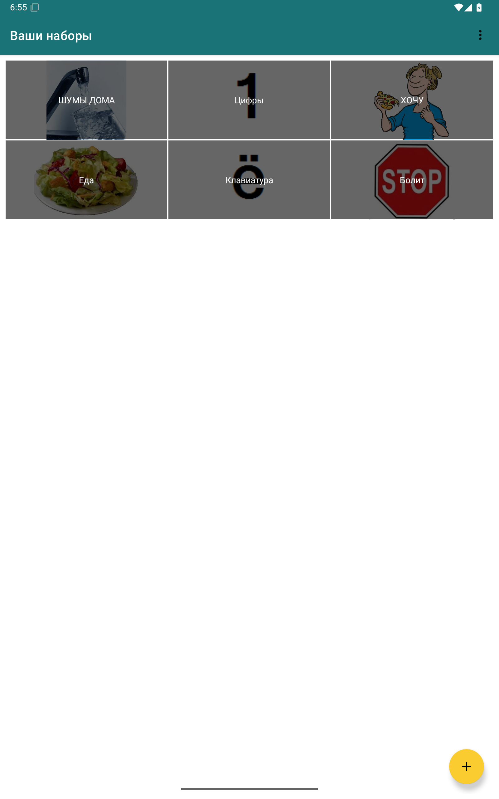

**Путь:** сохранить выключенную аналитику в первом уведомлении.

- **Телефон, P1/P2:** названия находятся прямо поверх затемнённых изображений и конкурируют с ними. Картинки уже имеют подписи/символы, поэтому некоторые сочетания трудно сканировать. Меню редактирования не обозначено на плитках, плюс не подписан.
- **Планшет, P2:** всё те же три колонки, но очень плоские широкие плитки; изображения занимают их середину. Значительная часть экрана пустая. Порядок второй строки отличается от телефона — на позицию нельзя уверенно полагаться между установками.
- **Для редизайна:** отделить читаемое название от обложки, сделать обнаруживаемыми действия набора, адаптировать размеры контейнеров. Не заменять знакомые пользователю изображения ради стилевого единообразия.

### 02b. Планшет: библиотека в альбоме

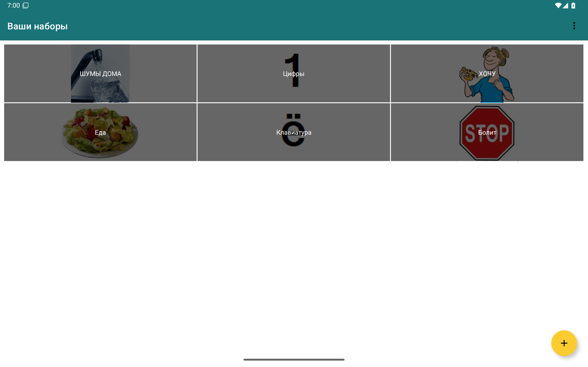

Три колонки сохраняются и на ширине 1280 dp: плитки растянуты горизонтально, картинки остаются небольшими, под двумя рядами много пустого места. **P2:** адаптивная компоновка должна учитывать окно и размер содержимого, а не просто растягивать три колонки. В этой версии нет дефекта с обрезанным началом названий, найденного в 2.0.

## 03. Меню библиотеки

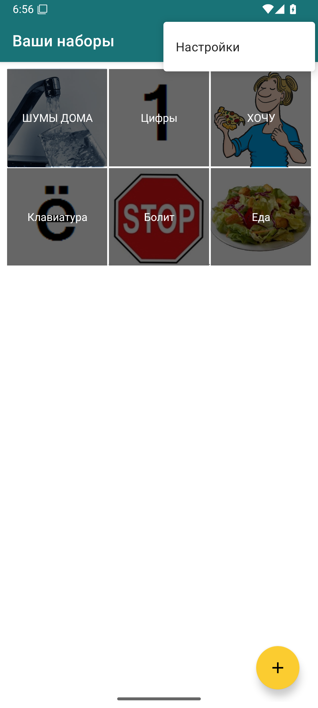
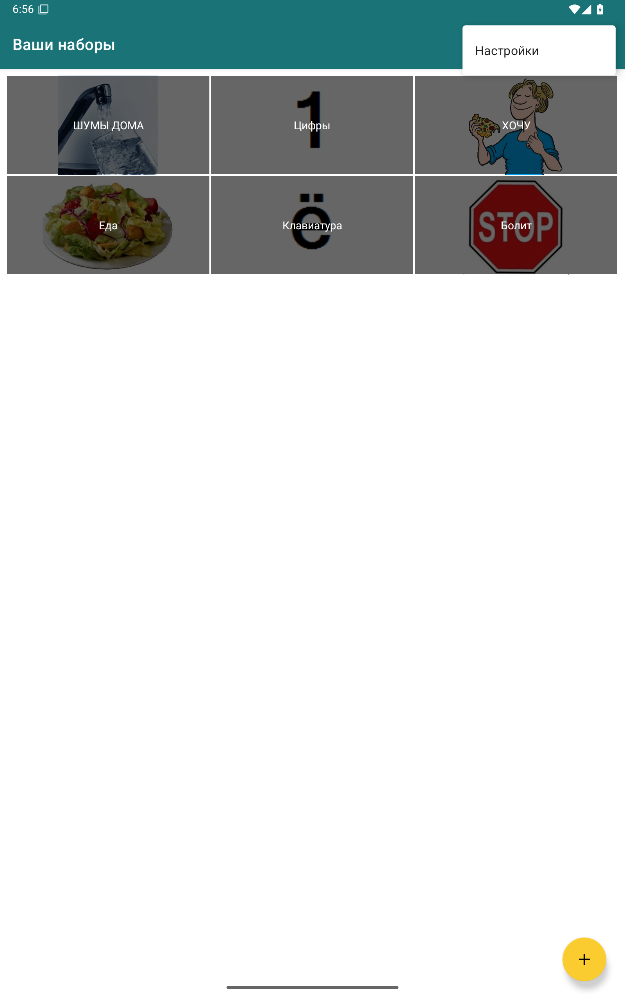

**Путь:** три точки в шапке.

- **Телефон:** одно действие «Настройки» спрятано за дополнительным нажатием; тёмная иконка меню менее заметна на бирюзовой панели, чем белый заголовок.
- **Планшет:** большая белая выпадающая область используется для одной строки; расстояние до нижней кнопки создания очень велико.
- **Для редизайна, P2/P3:** сделать доступ к настройкам понятнее; не добавлять сюда отсутствующие в 1.4 команды импорта/экспорта по аналогии с 2.0.

## 04. Общие настройки

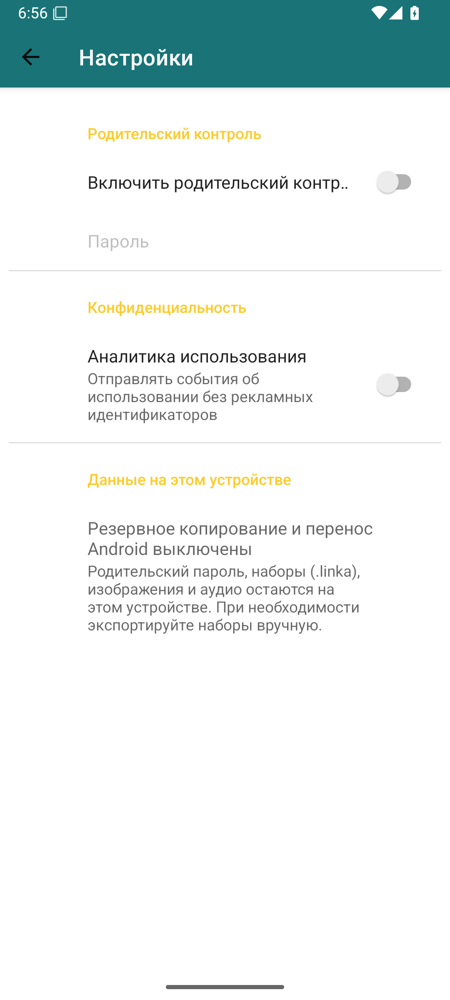
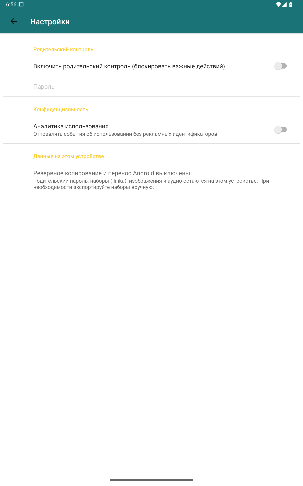

- **Телефон, P1/P2:** жёлтые названия секций слабо выделяются на белом. Название переключателя родительского контроля обрезано многоточием; в полном тексте есть ошибка «важные действий». Большой пустой левый отступ сокращает место для текста.
- **Планшет, P2:** подписи помещаются, но переключатели находятся далеко справа; пояснения растянуты длинными строками, ниже много пустоты. Инструкция предлагает экспортировать наборы, но видимого действия экспорта в этом интерфейсе нет.
- **Для редизайна:** контрастные секции, короткая формулировка контроля, удобная ширина текстового блока и реально доступный путь к сохранению данных. Не обещать несуществующий backup.

## 05. Установка родительского пароля

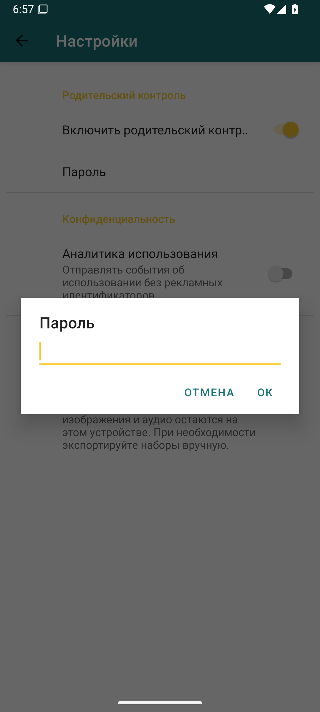
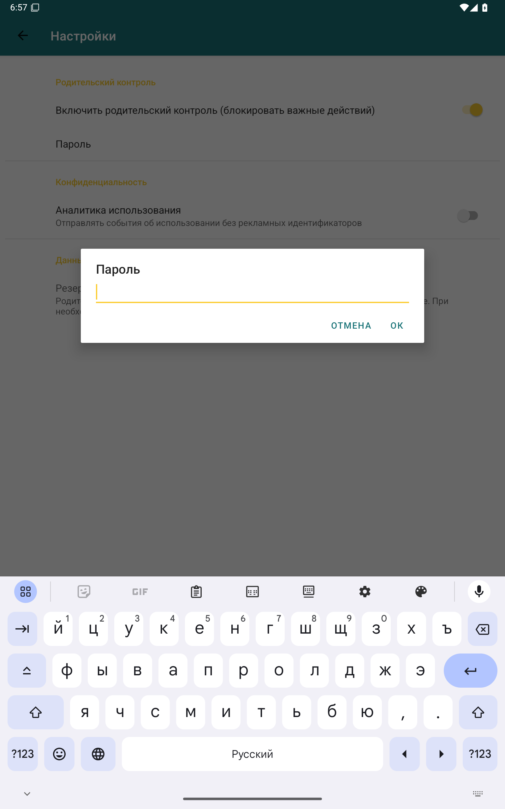

**Путь:** настройки → включить контроль → «Пароль».

- **Телефон, P2:** заголовок «Пароль» не говорит, новый это пароль или подтверждение старого. Поле без подсказки, проверки повторным вводом и видимого показа/скрытия.
- **Планшет:** диалог и клавиатура помещаются, но дополнительное пространство не используется для объяснения назначения пароля и последствий его потери.
- **Для редизайна:** явная форма задания пароля и краткое объяснение. Контроль уже включён до заполнения поля — это важный сценарий для отдельной проверки безопасности, а не только оформления.

## 06. Проверка родительского доступа

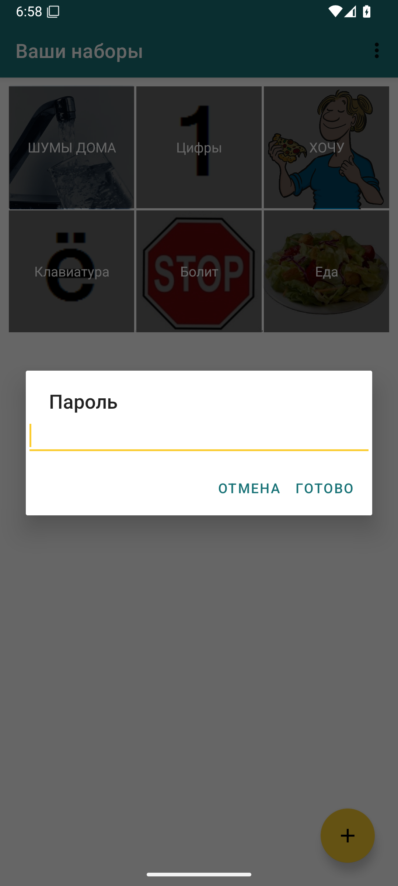
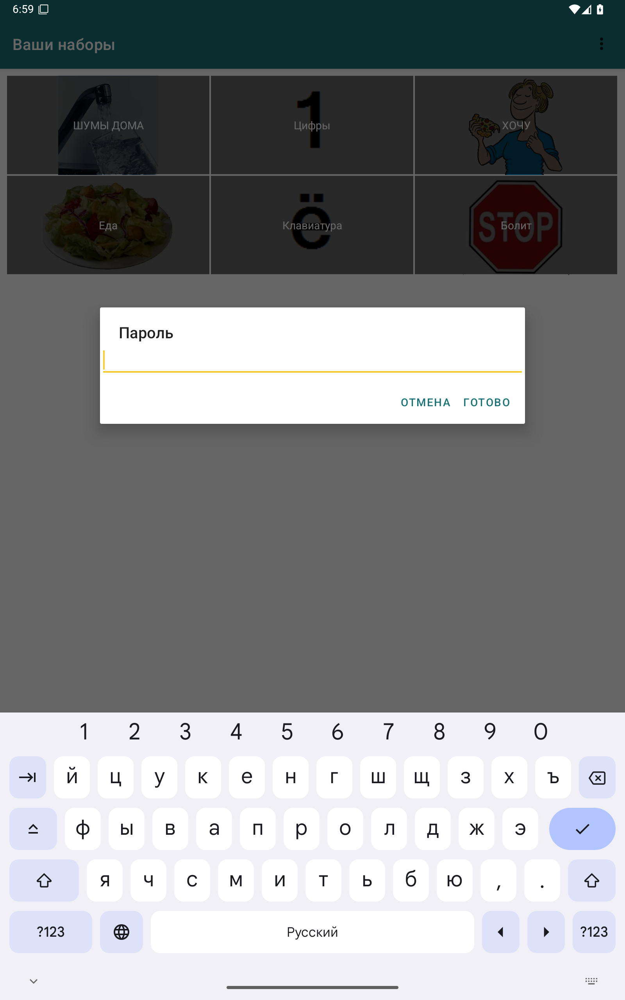

**Путь:** задать тестовый пароль → вернуться → снова открыть настройки.

- **Телефон, P2:** тот же заголовок «Пароль», но другая роль и другое подтверждение («Готово» вместо «ОК»). Цель запроса не объяснена.
- **Планшет:** запрос появляется поверх библиотеки, поэтому контекст лучше, чем серый экран 2.0; всё равно не сказано, какое действие защищено.
- **Для редизайна:** «Родительский пароль для открытия настроек», единые подписи действий и постоянная ошибка около поля. Для дальнейшего обхода контроль штатно выключен после успешного ввода тестового пароля.

## 07. Контекстное меню набора

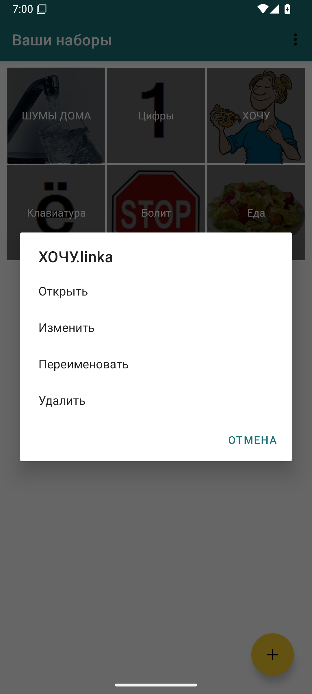
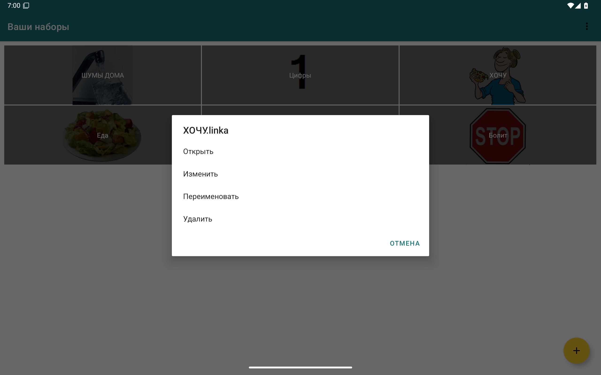

**Путь:** удерживать плитку «ХОЧУ».

- **Телефон, P2:** меню обнаруживается только долгим нажатием без подсказки. В заголовок попадает техническое расширение `.linka`. «Открыть» дублирует обычное касание.
- **Планшет:** меню сильно увеличено относительно четырёх простых действий; исходная плитка за ним не выделена, хотя название объекта показано.
- **Общее, P1:** «Удалить» визуально равноправно безопасным действиям. **Для редизайна:** явная точка входа в действия, человекочитаемое название и отделённое опасное действие.

## 08. Переименование

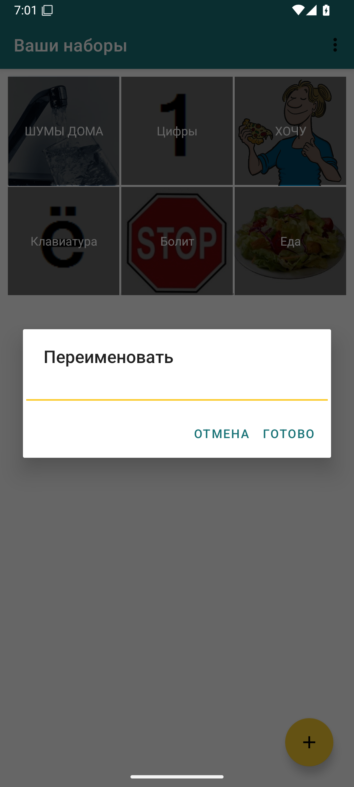
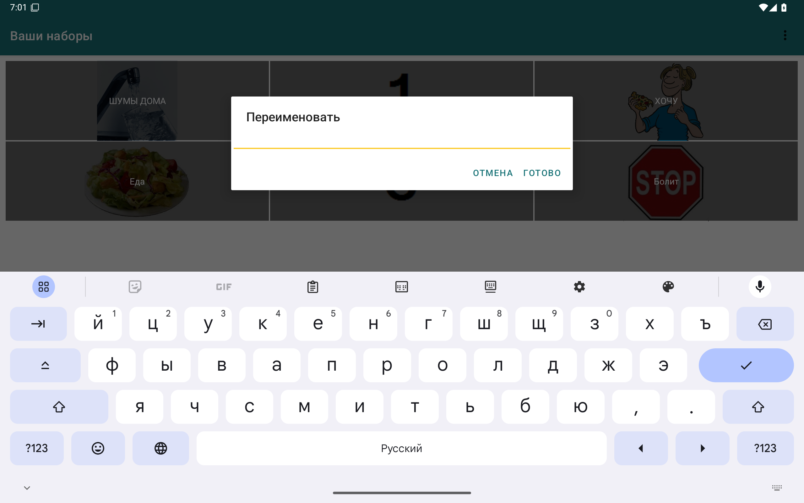

- **Телефон, P2:** поле пустое вместо текущего имени; не показано, какой набор переименовывается. Линия ввода почти касается краёв диалога и не согласована с отступами заголовка.
- **Планшет:** клавиатура помещается, но широкое поле не содержит примера или постоянной подписи.
- **Для редизайна:** подставить текущее имя, подписать поле и заменить «Готово» на «Переименовать»; валидацию показывать в форме, не теряя введённое.

## 09. Удаление набора

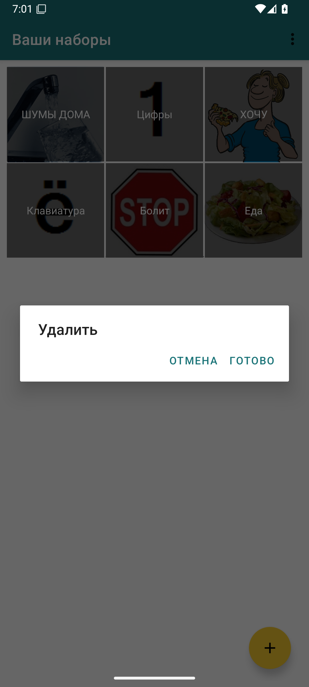
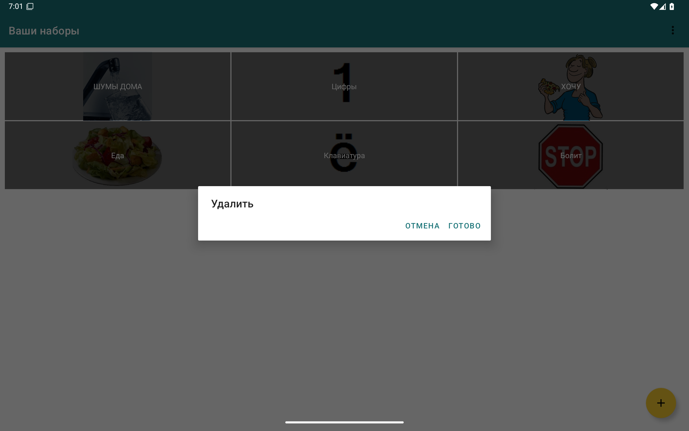

- **Телефон, P1:** только «Удалить» и «Готово». Нет имени, предупреждения о потере карточек и конкретного действия подтверждения.
- **Планшет, P1:** практически пустое широкое окно также не определяет объект и последствия. Его шаблон похож на безопасные подтверждения.
- **Для редизайна:** «Удалить набор „ХОЧУ“?» с последствиями и кнопкой «Удалить набор», заметно отличимой от отмены. Здесь удаление отменено.

## 10. «ХОЧУ»: пустая строка фразы

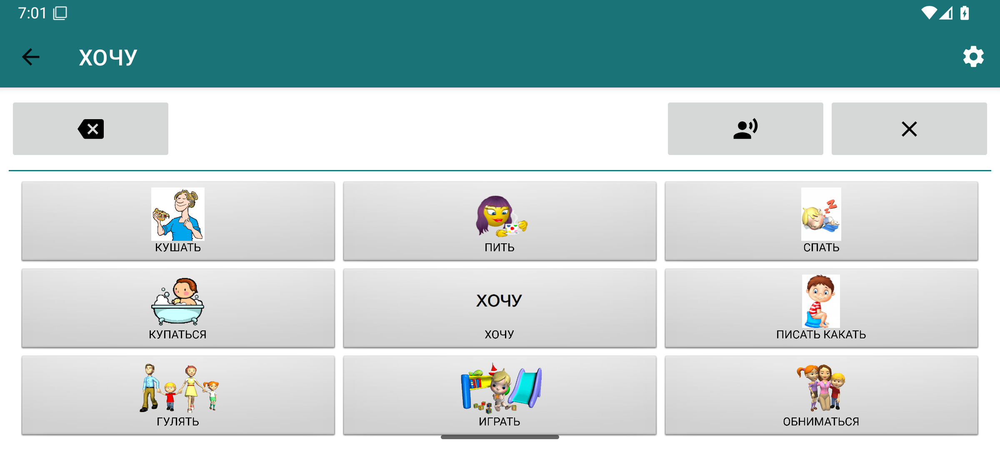
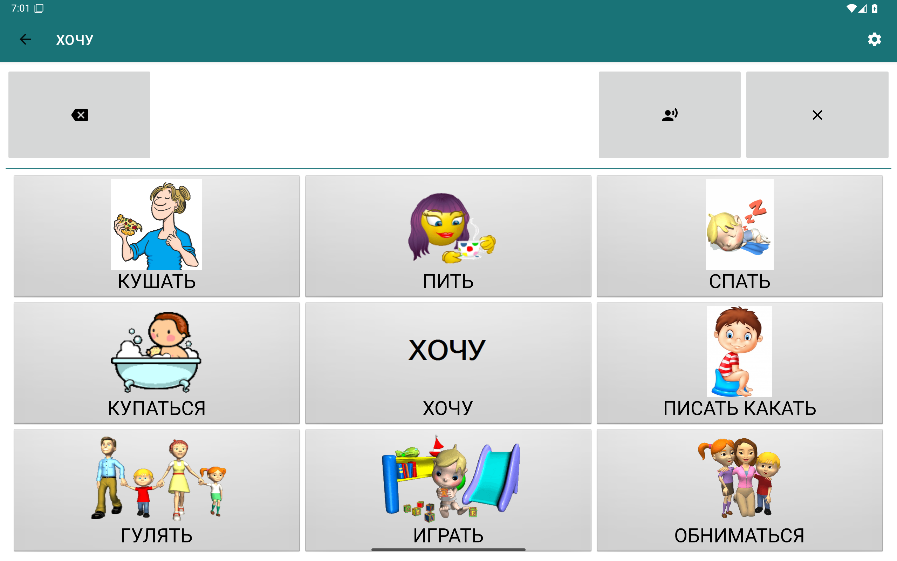

- **Телефон:** все девять карточек и действия доступны одновременно — это удачное свойство 1.4, которое надо сохранить. Но изображения и подписи небольшие внутри очень широких серых кнопок; нижний ряд вплотную подходит к жестовой панели.
- **Планшет:** карточки читаемее, но большие одинаковые кнопки удаления, произнесения и очистки не объяснены текстом; пустая фраза визуально не выделена как поле.
- **Для редизайна, P1/P2:** сохранить целую сетку и постоянную фразу, учесть системные отступы; различить «удалить последнюю», «очистить» и «произнести» по смыслу, не только значкам.

## 11. «ХОЧУ»: два элемента во фразе

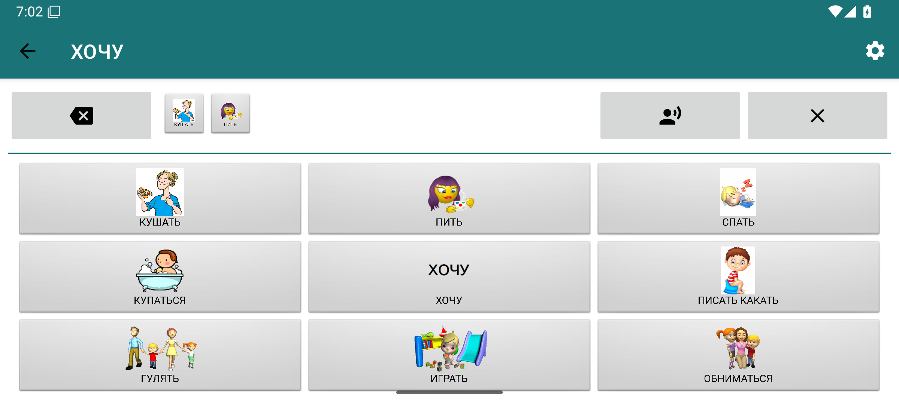
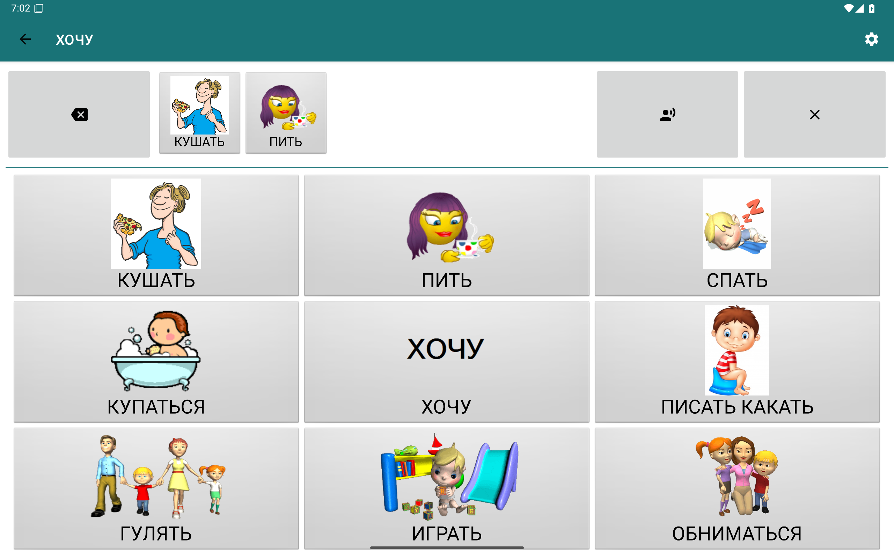

**Путь:** выбрать «КУШАТЬ» и «ПИТЬ».

- **Телефон, P1:** миниатюры выбранных карточек сильно меньше карточек доски; текст фразы трудно прочитать, хотя рядом много пустого места. У кнопок нет видимого отличия состояния от пустой фразы.
- **Планшет:** миниатюры читаются лучше, но сохраняется разрыв между очень крупными действиями и небольшими элементами фразы.
- **Для редизайна:** сохранить отсутствие скачка компоновки при выборе, увеличить читаемость результата и показать состояние произнесения/очистки. Не растить шапку настолько, чтобы сетка исчезала, как в 2.0.

## 12. Параметры доски

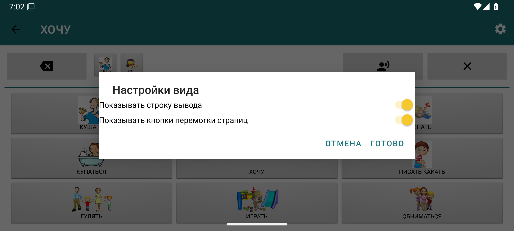
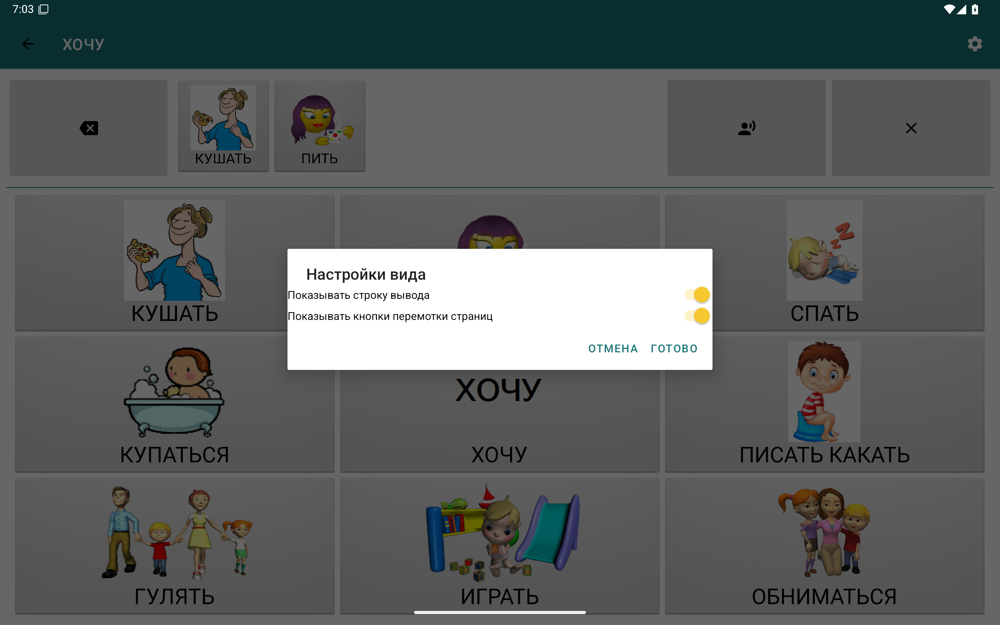

- **Телефон, P2:** «строка вывода» и «перемотка страниц» — технические формулировки; не объяснено, что выключение строки меняет действие карточки на немедленное произнесение.
- **Планшет:** подписи вплотную к левому краю, переключатели справа, отступы не совпадают с заголовком. Небольшое окно по центру достаточно, но оформление несогласовано.
- **Для редизайна:** ясные названия двух режимов, короткое пояснение и единые отступы. Наличие настроек не должно путаться с параметрами всего приложения.

## 13. Прямой режим

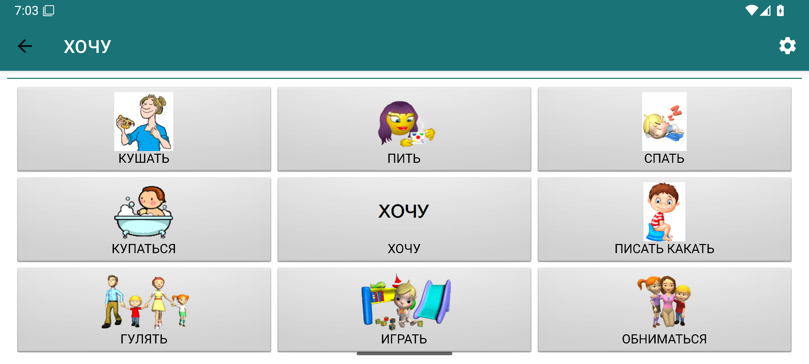
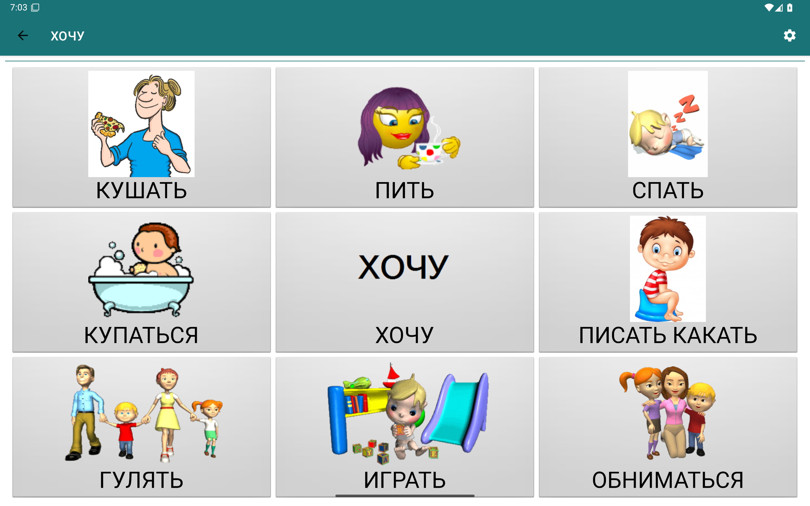

- **Телефон:** изображения стали крупнее и все девять карточек сохранились. Однако экран не показывает, что теперь касание сразу озвучивает карточку, а не добавляет её во фразу.
- **Планшет:** сетка хорошо заполняет экран; некоторые низкокачественные исходные изображения заметно размыты при увеличении. Нижние ячейки соприкасаются с жестовой областью.
- **Для редизайна, P2:** небольшой ясный индикатор режима, правильные системные отступы и аккуратное масштабирование без замены знакомых символов.

## 14. «Цифры»: первая страница

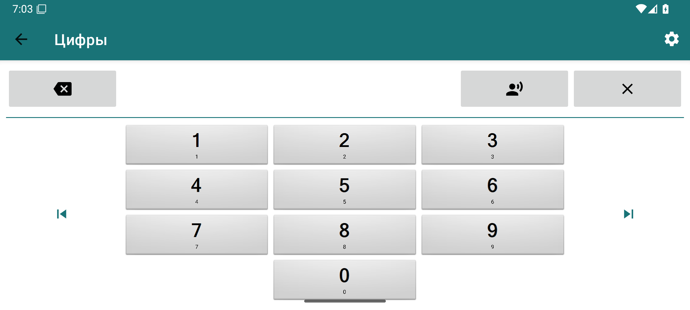
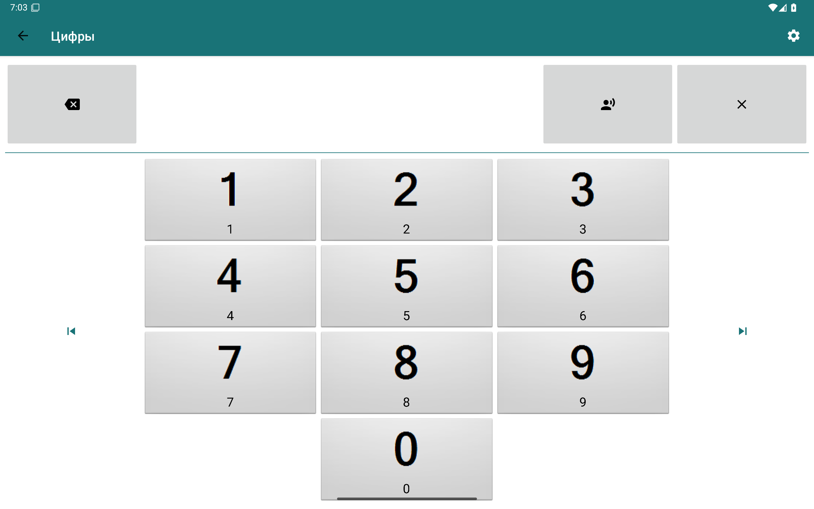

- **Телефон, P1/P2:** значки пагинации небольшие и без номера страницы/границ. Числа дублируются картинкой и очень мелкой подписью; большой боковой отступ уменьшает полезную сетку.
- **Планшет:** числа читаются крупнее, но остаются широкие пустые боковые зоны, а нижний ноль касается системной панели.
- **Для редизайна:** понятная пагинация и читаемые символы с устойчивым расположением; не копировать мелкую подпись там, где она ничего не добавляет.

## 15. «Цифры»: вторая страница

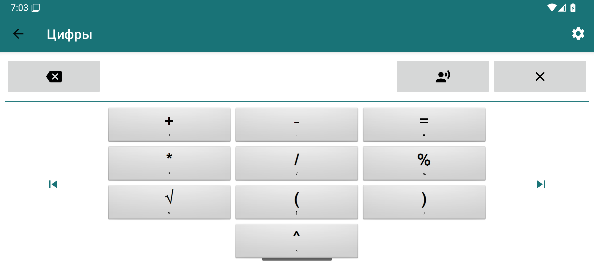
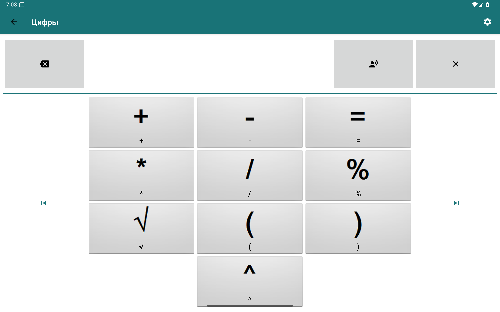

- **Телефон, P2:** страница сменилась, но счётчика нет, обе стрелки выглядят одинаково доступными. Мелкая повторная подпись корня/операторов почти бесполезна для распознавания.
- **Планшет:** математические символы видны, однако боковые зоны и поле фразы забирают много пространства, нижний оператор стоит близко к жестовой панели.
- **Для редизайна:** чётко обозначить текущую страницу и край диапазона; для нескольких страниц не заставлять пользователя угадывать результат стрелки.

## 16. «ШУМЫ ДОМА»

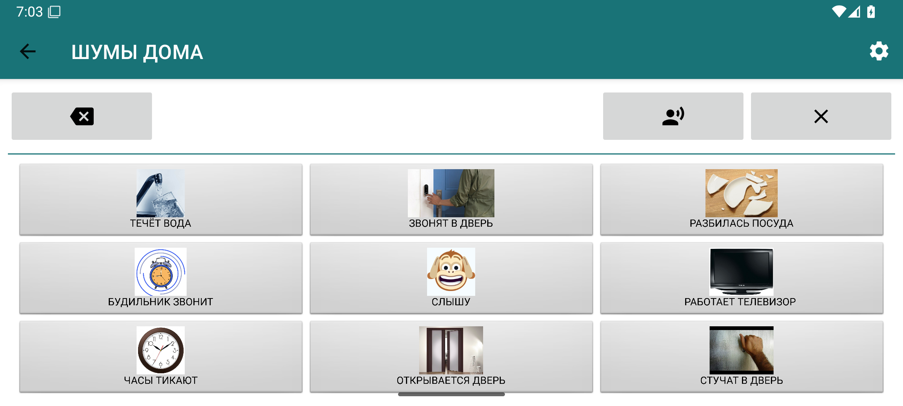
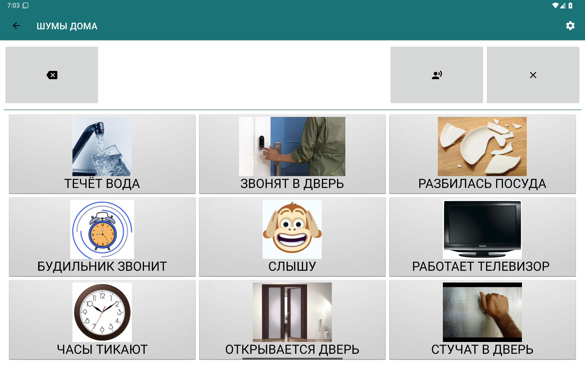

- **Телефон, P2:** все девять карточек доступны, но длинные подписи уменьшены до мелкого текста. Изображения занимают небольшую центральную часть широких кнопок.
- **Планшет:** подписи читаются лучше; фотографии, эмодзи и рисунки имеют разные фон/масштаб и отвлекают друг от друга. Это свойства содержимого, не основание удалить привычные карточки.
- **Для редизайна:** повысить читаемость длинных названий, согласовать контейнер и границы изображения, сохранить знакомую сетку.

## 17. «Клавиатура»: первая страница

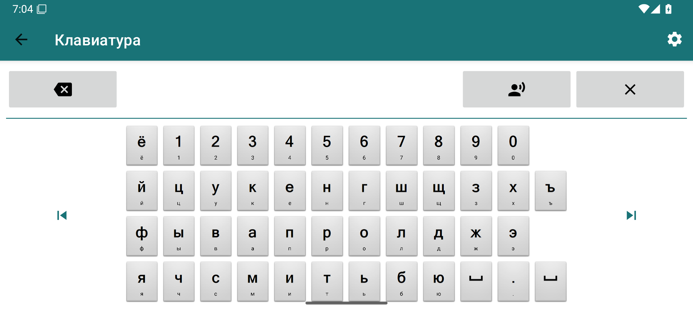
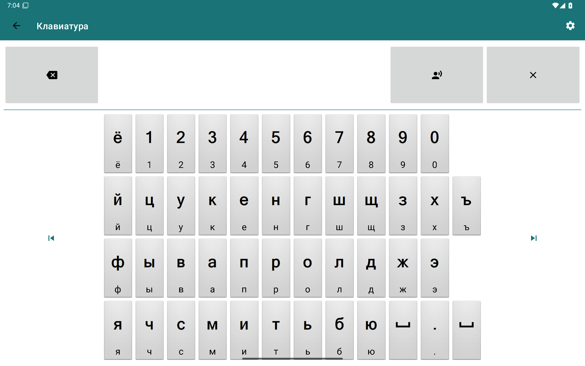

- **Телефон, P1:** 46 узких клавиш помещаются, но подпись под символом очень мелкая, а большие боковые зоны могли бы помогать размерам клавиш. Необычный знак пробела без подписи неочевиден.
- **Планшет:** высота клавиш велика относительно ширины; символ дублируется дважды. Набор выглядит как сжатые фотокарточки, а не клавиатура.
- **Для редизайна:** сохранить раскладку и возможность видеть весь набор, но привести пропорции и обозначение пробела к задаче набора текста; не сокращать зоны касания ради красоты.

### 17b. Вторая страница клавиатуры

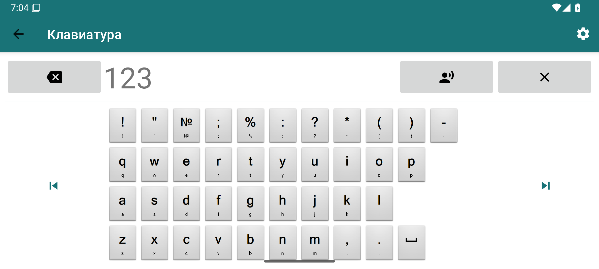
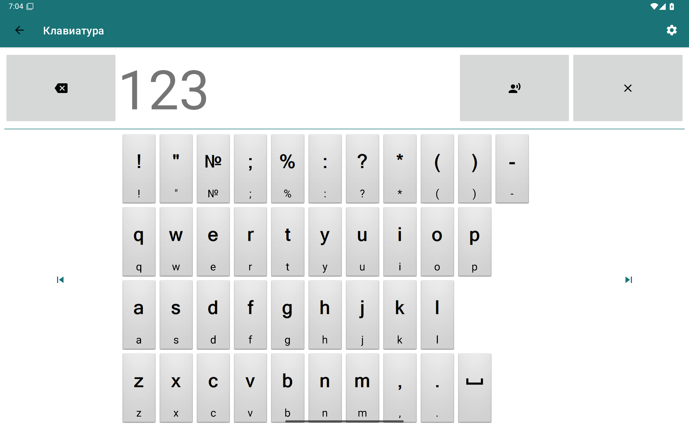

**Телефон:** латиница и знаки открылись, но номер/язык страницы не подписан; сохранённый текст «123» виден сверху. **Планшет:** текст крупный, при этом клавиши всё равно узкие, строки имеют разную длину. **P2:** показать группу символов и текущую страницу, сохранить ясный пробел и положение уже введённого текста.

### 17c. Введённый текст

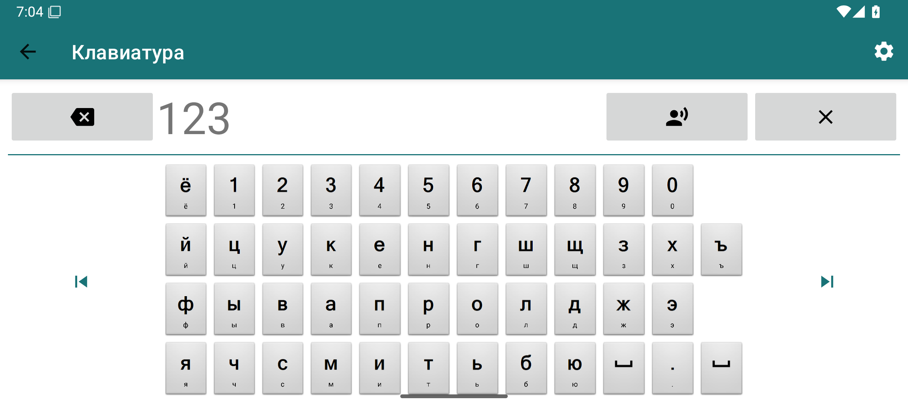
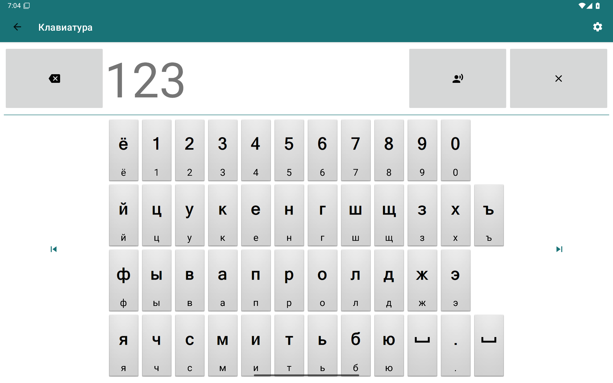

**Телефон:** «123» видно без прокрутки — полезное отличие от карточной фразы. Серый текст визуально похож на неактивный, а кнопка очистки рядом по размеру равноправна произнесению. **Планшет:** результат очень крупный по сравнению с клавишами, но не выглядит как отдельная подписанная область набора. **P2:** ясная зона сообщения и понятная иерархия действий без потери постоянной видимости текста.

## 18. «Еда»

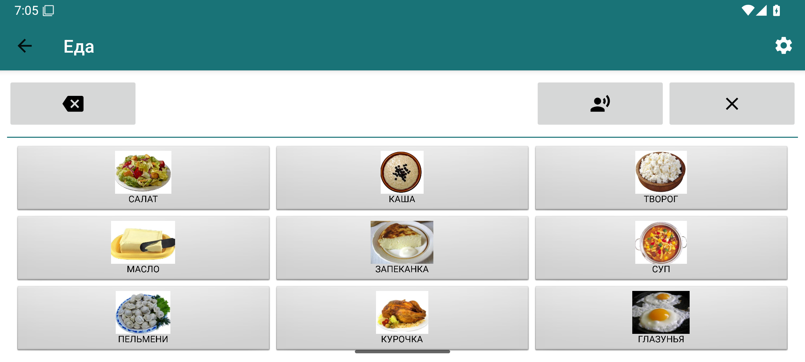
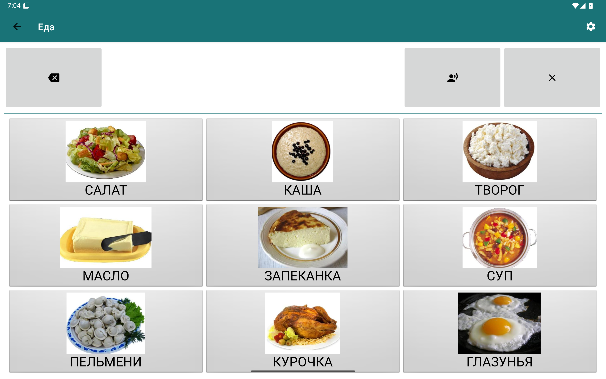

- **Телефон, P2:** все карточки на экране, но подписи и изображения небольшие относительно серых полей. Длинная «Запеканка» уменьшается вместе с остальными названиями.
- **Планшет:** еда хорошо различима, однако фон, масштаб и качество фотографий заметно разнятся; область карточек почти касается системной панели снизу.
- **Для редизайна:** улучшить читаемость и использование площади контейнеров, не обрезать предметы и сохранить пользовательские фото.

## 19. «Болит»

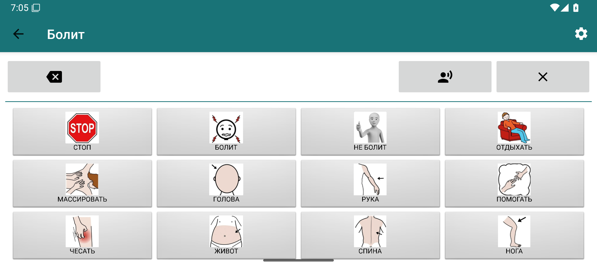
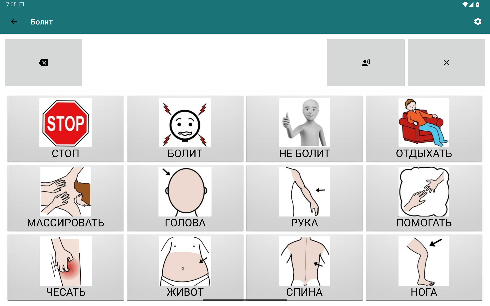

- **Телефон, P1/P2:** все 12 карточек доступны без прокрутки, но мелкие подписи частей тела могут замедлить выбор. Разница «Болит» / «Не болит» зависит главным образом от картинки и текста.
- **Планшет:** подписи крупнее, но сильная разностильность иллюстраций и неодинаковая детализация заставляют заново распознавать каждый символ.
- **Для редизайна:** быстрый стабильный выбор, читаемые названия и сохранение знакомых позиций. Цвет STOP можно поддержать оформлением, но нельзя делать цвет единственным носителем смысла.
